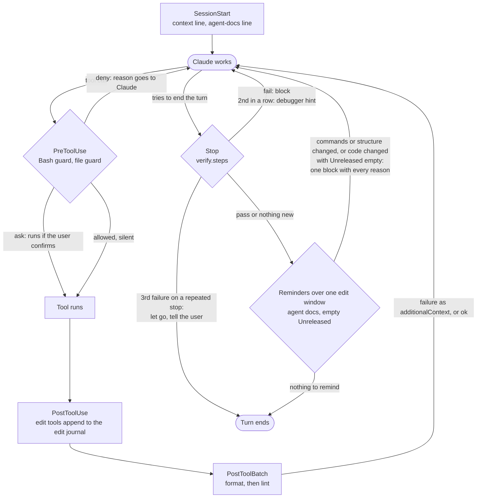

**English** · [Русский](README.ru.md)

# forge

A Claude Code plugin that gives a session process discipline through hooks, not prompt pleading: git and secret guards, format and lint after edits, verification before a turn ends, a per-project profile, and model and effort routing for role subagents.

[](https://github.com/lunasy26/forge/actions/workflows/test.yml)
[](CHANGELOG.md)
[](LICENSE)
[](package.json)
[](package.json)
[](https://code.claude.com/docs/en/plugins)

Whatever must always or never happen is done by hooks and the `forge` CLI; skills stay where judgment is needed.

Without `.forge/profile.json` only the [Bash guard](docs/en/guards.md#bash-guard) and the [file guard](docs/en/guards.md#file-guard) run, with built-in defaults (branches `main` and `master`, `.env*` files and keys are protected). There is no lint and no auto-verification, and the hooks write nothing into the repository. In a git repository without a profile, session start adds one line suggesting `/forge:init`; outside a git repository, nothing.

> forge talks in the language you write in, English or Russian: CLI output, hook reasons (prefixed `forge:`) and profile errors. It follows your latest message in the session, then the remembered language and the system locale, and falls back to English. To force a language, set `"language": "en"` or `"ru"` in the profile, or `FORGE_LANG`; details are in [Message language](docs/en/hooks.md#message-language). The [documentation](#documentation) quotes the Russian messages verbatim and translates them in parentheses.

## Why forge

- **Mechanics instead of pleading.** Rules that must hold every time live in hooks and a CLI, not in capitalised prompt text that the model may or may not follow.
- **A safety net from the first session.** Push to `main`, force push, `--no-verify`, edits to `.env` and keys are stopped even in a project that was never set up.
- **A turn doesn't end on red.** After edits, verification runs before Claude finishes; a failure goes back to Claude, the second one in a row escalates to a `debugger` role, and the third releases the session instead of looping.
- **The right model for each job.** Every subagent role gets a model and effort from a table, and one switch (`eco`, `normal`, `max`) moves the whole table.
- **Quiet by default.** Allowed actions print nothing, session start adds at most 600 characters, and without a profile nothing is written to the repository.

## Features

| Feature | What you get |
|---|---|
| [Bash guard](docs/en/guards.md#bash-guard) | `deny` for `git push` to protected branches, force push, `--mirror`, `--no-verify`; `ask` before `git reset --hard`, `git push --all` and `rm -r` outside the project. Sees through `bash -c`, `eval` and `$(…)` |
| [File guard](docs/en/guards.md#file-guard) | `deny` for edit tools on `.env*`, keys and paths from `protected_files` |
| [Format and lint](docs/en/hooks.md#format-and-lint) | After each batch of tool calls, `format` and `lint` run on the files just edited; failures reach Claude as context |
| [Verification on Stop](docs/en/hooks.md#verification-on-stop) | `verify.steps` run before a turn ends; a failure keeps the turn going, the second in a row calls in `debugger`, the third lets go |
| [Agent files](docs/en/agent-docs.md#layout) | `AGENTS.md` is the source, `CLAUDE.md` imports it; `forge docs` checks the layout, `/forge:docs` writes the files. New in 0.3.0 |
| [Agent docs reminder](docs/en/agent-docs.md#agent-docs-reminder) | When a turn changes commands or project structure, Claude is asked once to check `AGENTS.md`/`CLAUDE.md`. New in 0.3.0 |
| [Releases and CHANGELOG](docs/en/releases.md) | Opt-in `release` section: `forge release` checks a Keep a Changelog file, previews and cuts a version (changelog, version files, commit, tag; never pushes); a reminder when code changed but `[Unreleased]` is empty; `/forge:release`. New in 0.4.0 |
| [Session start context](docs/en/hooks.md#session-start-context) | Up to 600 characters: mode, checks, active task, warnings |
| [Profile](docs/en/profile.md) | `.forge/profile.json` with a JSON Schema; stack detection for Node/TS, Python, Swift, Go and Rust |
| [Model routing](docs/en/routing.md) | Model and effort per subagent role from the `eco`/`normal`/`max` table, checked by invariants; aliases can be [mapped to other models](docs/en/routing.md#using-other-models) |
| [Skills](docs/en/skills.md) | `/forge:init`, `/forge:mode`, `/forge:plan`, `/forge:execute`, `/forge:review`, `/forge:docs`, `/forge:release` |
| [forge CLI](docs/en/cli.md) | `init`, `state`, `mode`, `route`, `verify`, `docs`, `release`, `doctor` |

## Session lifecycle



[SessionStart](docs/en/hooks.md#session-start-context) adds a short context. Every tool call passes the [Bash guard](docs/en/guards.md#bash-guard) or the [file guard](docs/en/guards.md#file-guard). Edits are journaled and [formatted and linted](docs/en/hooks.md#format-and-lint) after each batch. When Claude tries to finish, [verification](docs/en/hooks.md#verification-on-stop) runs, then the one-shot reminders over one shared window of edits: the [agent docs reminder](docs/en/agent-docs.md#agent-docs-reminder) and, if the profile has a `release` section, the [reminder about an empty `[Unreleased]`](docs/en/releases.md#reminder-about-an-empty-unreleased). If both fire, Claude gets one block with both reasons. Every hook is in the [hook table](docs/en/hooks.md#hook-table).

## Requirements

- Node.js ≥ 20 on `PATH`. No dependencies.
- `git` and `/bin/sh`: verification commands run through it. macOS and Linux are supported.
- Claude Code with plugin hooks, including the `PostToolBatch` event, and the plugin's `bin/` directory on the Bash tool's `PATH`.

## Installation

### From GitHub

The repository is public, no credentials needed. In Claude Code:

```
/plugin marketplace add lunasy26/forge
/plugin install forge@forge-dev
```

`forge-dev` is the marketplace name from `.claude-plugin/marketplace.json`: the repository is its own marketplace. See [Plugin marketplaces](https://code.claude.com/docs/en/plugin-marketplaces) in the Claude Code docs.

### Local development

```bash
claude --plugin-dir /path/to/forge
```

While the plugin is enabled, the `forge` CLI is available in Claude Code's Bash tool. Outside Claude Code: `node /path/to/forge/bin/forge <command>`. Working on forge itself: [Development](docs/en/development.md).

### Superpowers conflict

forge replaces Superpowers and conflicts with it. If `superpowers@…` is enabled in `enabledPlugins` (read from `~/.claude/settings.json` or `$CLAUDE_CONFIG_DIR/settings.json`, then the project's `.claude/settings.json` and `.claude/settings.local.json`; a later file overrides an earlier one), forge warns at [session start](docs/en/hooks.md#session-start-context) and in [`forge doctor`](docs/en/cli.md#commands). Disable it through `/plugin`. Superpowers is recognised only by `enabledPlugins` in these three settings files.

## Quick start

```
/forge:init → forge doctor → /forge:docs → /forge:mode, /forge:plan → /forge:execute → /forge:review
```

1. **`/forge:init`** in the project. The skill runs `forge init` (preview only) and shows the stack, verification steps, `verify.on_stop`, protected branches and risky paths. It asks only about what it couldn't [detect](docs/en/profile.md#stack-detection), then writes the [profile](docs/en/profile.md) (`forge init --yes`; see [what init writes](docs/en/profile.md#what-init-writes)) and runs `forge doctor`.
2. **`forge doctor`.** Its `✗` lines are what to fix, for example a verification command that isn't on `PATH`.
3. **`/forge:docs`**, if the project has no `AGENTS.md`: `/forge:init` offers it at the end. It drafts the [agent files](docs/en/agent-docs.md#layout) from the project and writes nothing without your yes. If only the `CLAUDE.md` links are missing, `/forge:init` offers `forge docs --fix` instead.
4. **Day to day.** Small edits — work as usual: [lint](docs/en/hooks.md#format-and-lint) and [verification](docs/en/hooks.md#verification-on-stop) fire on their own. `/forge:mode eco|normal|max` picks the [model table](docs/en/routing.md#models-by-mode).
5. **A feature across several files**: `/forge:plan` (spec and task plan, waits for your yes), then `/forge:execute`, then `/forge:review`. See [Skills](docs/en/skills.md).

## Documentation

- [Hooks](docs/en/hooks.md) — the hook table, fail-open and fail-closed, session start context, format and lint after edits, verification on Stop, the end-of-turn reminders, message language.
- [Guards](docs/en/guards.md) — the Bash guard and the file guard: how a command is read, rules and verdicts, abbreviated git options, recursive `rm`, protected branches and files.
- [Profile](docs/en/profile.md) — `.forge/profile.json`: an example, every field with its default, a broken profile, stack detection, what `forge init` writes.
- [Model routing](docs/en/routing.md) — roles, models by mode, the retry ladder, invariants, overrides, and using other models and providers.
- [Agent files](docs/en/agent-docs.md) — the `AGENTS.md`/`CLAUDE.md` layout, `forge docs` and its issue codes, the agent docs reminder.
- [Releases and CHANGELOG](docs/en/releases.md) — `forge release`, choosing the level, version files, changelog checks, the empty-`[Unreleased]` reminder, `/forge:release`.
- [Skills](docs/en/skills.md) — every `/forge:*` skill and the plan task format.
- [forge CLI](docs/en/cli.md) — every command with its exit codes, the project root.
- [Files and state](docs/en/state.md) — the `.forge/` directory, the state file, the edit journal and its cursors.
- [Development](docs/en/development.md) — repository layout, tests, adding a guard rule or a role.

## Links

### Project documents

- [CHANGELOG.md](CHANGELOG.md) — release history.
- [docs/spec.md](docs/spec.md) — specification and design decisions. It started as the v0.1 draft; its versions section also lists what's next and not yet built: task tiers and `risky_paths` in hooks, `SubagentStart`, the `mechanic` and `architect` agents, the `debug` and `finish` skills.
- [AGENTS.md](AGENTS.md) — rules for developing forge, for people and agents.
- [LICENSE](LICENSE) — MIT.

### Claude Code documentation

- [Hooks reference](https://code.claude.com/docs/en/hooks) — events, matchers, `decision`, `additionalContext`, `PostToolBatch`.
- [Plugins](https://code.claude.com/docs/en/plugins) and the [plugins reference](https://code.claude.com/docs/en/plugins-reference) — plugin structure and manifest.
- [Plugin marketplaces](https://code.claude.com/docs/en/plugin-marketplaces) — how `/plugin marketplace add` works.
- [Subagents](https://code.claude.com/docs/en/sub-agents) — agent files, `model` and tools.
- [Skills](https://code.claude.com/docs/en/skills) — `SKILL.md`, `description`, `disable-model-invocation`.
- [Memory](https://code.claude.com/docs/en/memory) — `CLAUDE.md`, `@` imports, nested files.
- [Model configuration](https://code.claude.com/docs/en/model-config) — model aliases, `ANTHROPIC_DEFAULT_*_MODEL`, effort.

### Conventions

- [AGENTS.md](https://agents.md/) — the open format for agent instructions.
- [Keep a Changelog](https://keepachangelog.com/en/1.1.0/) — the CHANGELOG format.
- [Semantic Versioning](https://semver.org/) — version numbers.

## License

MIT — see [LICENSE](LICENSE).
