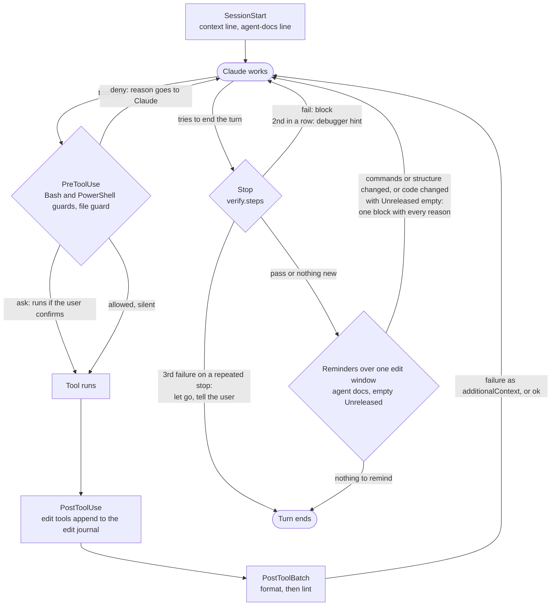

<a id="readme-top"></a>

<p align="center"><b>English</b> · <a href="README.ru.md">Русский</a></p>

<h1 align="center">forge</h1>

<p align="center">
  <b>Process discipline for Claude Code — enforced by hooks, not by pleading in the prompt.</b><br/>
  Git and secret guards · format and lint after edits · verification before a turn ends · model routing for subagents
</p>

<p align="center">
  <a href="https://github.com/lunasy26/forge/actions/workflows/test.yml"></a>
  <a href="CHANGELOG.md"></a>
  <a href="LICENSE"></a>
  <a href="package.json"></a>
  <a href="package.json"></a>
  <a href="https://code.claude.com/docs/en/plugins"></a>
</p>

<p align="center">
  <a href="#installation">Installation</a> ·
  <a href="#quick-start">Quick start</a> ·
  <a href="#features">Features</a> ·
  <a href="#how-it-works">How it works</a> ·
  <a href="#documentation">Documentation</a> ·
  <a href="CHANGELOG.md">Changelog</a>
</p>

```
/plugin marketplace add lunasy26/forge
/plugin install forge@forge-dev
```

Whatever must always or never happen is done by hooks and the `forge` CLI; skills stay where judgment is needed.

## Why forge

- **Mechanics instead of pleading.** Rules that must hold every time live in hooks and a CLI, not in capitalised prompt text that the model may or may not follow.
- **A safety net from the first session.** Push to `main`, force push, `--no-verify`, edits to `.env` and keys are stopped, in Bash and in PowerShell, even in a project that was never set up.
- **A turn doesn't end on red.** After edits, verification runs before Claude finishes; a failure goes back to Claude, the second one in a row escalates to a `debugger` role, and the third releases the session instead of looping.
- **The right model for each job.** Every subagent role gets a model and effort from a table, and one switch (`eco`, `normal`, `max`) moves the whole table.
- **Quiet by default.** Allowed actions print nothing, session start adds at most 600 characters, and without a profile nothing is written to the repository.

Without `.forge/profile.json` only the [Bash guard](docs/en/guards.md#bash-guard), the [PowerShell guard](docs/en/guards.md#powershell-guard) and the [file guard](docs/en/guards.md#file-guard) run, with built-in defaults (branches `main` and `master`, `.env*` files and keys are protected). There is no lint and no auto-verification, and the hooks write nothing into the repository. In a git repository without a profile, session start adds one line suggesting `/forge:init`; outside a git repository, nothing.

> [!NOTE]
> forge talks in the language you write in, English or Russian: CLI output, hook reasons (prefixed `forge:`) and profile errors. It follows your latest message in the session, then the remembered language and the system locale, and falls back to English. To force a language, set `"language": "en"` or `"ru"` in the profile, or `FORGE_LANG`; details are in [Message language](docs/en/hooks.md#message-language). The [documentation](#documentation) quotes the Russian messages verbatim and translates them in parentheses.

<p align="right"><a href="#readme-top">↑ back to top</a></p>

## Installation

<p align="center"><a href="#requirements">Requirements</a> · <a href="#macos">macOS</a> · <a href="#linux">Linux</a> · <a href="#windows">Windows</a> · <a href="#check-the-installation">Check</a> · <a href="#updating">Updating</a> · <a href="#local-development">Local development</a></p>

### Requirements

| | |
|---|---|
| **Node.js ≥ 20** | on `PATH`; hooks and the CLI are plain Node with zero dependencies, nothing to `npm install` |
| **git** and **`/bin/sh`** | verification, format and lint commands run through `/bin/sh`, or through Git Bash on Windows |
| **Claude Code** | with plugin hooks, including the `PostToolBatch` event |
| **OS** | macOS, Linux, Windows (natively with Git for Windows, or through WSL 2) |

The repository is public, no credentials are needed. `forge-dev` in the install command is the marketplace name from `.claude-plugin/marketplace.json`: the repository is its own marketplace. See [Discover and install plugins](https://code.claude.com/docs/en/discover-plugins) and [Plugin marketplaces](https://code.claude.com/docs/en/plugin-marketplaces).

### macOS

1. **Node.js and git.** With [Homebrew](https://brew.sh):

   ```bash
   brew install node git
   ```

   Without Homebrew, `xcode-select --install` gives you git, and [nodejs.org](https://nodejs.org/en/download) has an installer for Node.

2. **Claude Code** ([setup guide](https://code.claude.com/docs/en/setup)):

   ```bash
   curl -fsSL https://claude.ai/install.sh | bash
   ```

3. **forge.** Start `claude` in any directory and run:

   ```
   /plugin marketplace add lunasy26/forge
   /plugin install forge@forge-dev
   ```

### Linux

1. **Node.js and git.** Take Node from your distribution if it is 20 or newer:

   ```bash
   sudo apt install nodejs git        # Debian, Ubuntu
   sudo dnf install nodejs git        # Fedora
   sudo pacman -S nodejs git          # Arch
   ```

   Check with `node --version`. Older LTS releases of Debian and Ubuntu ship Node below 20; then install it with [nvm](https://github.com/nvm-sh/nvm#installing-and-updating) (`nvm install --lts`) or from [nodejs.org](https://nodejs.org/en/download).

2. **Claude Code** ([setup guide](https://code.claude.com/docs/en/setup)):

   ```bash
   curl -fsSL https://claude.ai/install.sh | bash
   ```

3. **forge.** Start `claude` and run:

   ```
   /plugin marketplace add lunasy26/forge
   /plugin install forge@forge-dev
   ```

### Windows

Two ways: **natively** (PowerShell and [Git for Windows](https://git-scm.com/download/win)) or inside **WSL 2**, where forge behaves exactly as on Linux.

#### Native Windows

1. **Node.js and Git for Windows.** In PowerShell:

   ```powershell
   winget install OpenJS.NodeJS.LTS
   winget install Git.Git
   ```

   Or use the installers from [nodejs.org](https://nodejs.org/en/download) and [git-scm.com](https://git-scm.com/download/win). Open a new terminal afterwards so `PATH` is refreshed.

2. **Claude Code** ([setup guide](https://code.claude.com/docs/en/setup)), in PowerShell:

   ```powershell
   irm https://claude.ai/install.ps1 | iex
   ```

3. **forge.** Start `claude` and run:

   ```
   /plugin marketplace add lunasy26/forge
   /plugin install forge@forge-dev
   ```

If Claude Code does not find Git Bash, set its path in `settings.json`:

```json
{ "env": { "CLAUDE_CODE_GIT_BASH_PATH": "C:\\Program Files\\Git\\bin\\bash.exe" } }
```

> [!NOTE]
> Verification, format and lint commands run in Git Bash, which comes with Git for Windows. Without it the guards still work (including the [PowerShell guard](docs/en/guards.md#powershell-guard)), but those checks are skipped (not failed; you get a one-time notice); `forge doctor` shows whether Git Bash was found.

#### WSL 2

1. **WSL 2.** In PowerShell as administrator, then restart the computer:

   ```powershell
   wsl --install
   ```

   This installs Ubuntu by default. Details: [Install WSL](https://learn.microsoft.com/windows/wsl/install).

2. **Everything else — inside the WSL terminal.** Open Ubuntu from the Start menu and follow the [Linux](#linux) steps. Keep your projects in the WSL file system (`~/…`, not `/mnt/c/…`): it is much faster. Run `claude` in the WSL terminal, not in PowerShell; in VS Code, open the folder through the [WSL extension](https://code.visualstudio.com/docs/remote/wsl).

### Check the installation

1. In Claude Code, open `/plugin` → **Installed**: `forge` is listed and enabled.
2. Open a git project and run `/forge:init`. It previews a profile, asks about what it couldn't detect, writes `.forge/profile.json` and ends with `forge doctor`.
3. Lines with `✗` in the `forge doctor` output are what to fix, for example a verification command that isn't on `PATH`. You can rerun it any time: ask Claude to run `forge doctor`.

### Updating

Third-party marketplaces have auto-update off by default. Refresh the listing, update the plugin, reload:

```
/plugin marketplace update forge-dev
```

```bash
claude plugin update forge@forge-dev
```

```
/reload-plugins
```

Instead of the shell command you can use **Update marketplace** on the **Marketplaces** tab of `/plugin`. What changed in each version: [CHANGELOG.md](CHANGELOG.md).

### Local development

```bash
claude --plugin-dir /path/to/forge
```

While the plugin is enabled, the `forge` CLI is available in Claude Code's Bash tool. Outside Claude Code: `node /path/to/forge/bin/forge <command>`. Working on forge itself: [Development](docs/en/development.md).

### Superpowers conflict

forge replaces Superpowers and conflicts with it. If `superpowers@…` is enabled in `enabledPlugins` (read from `~/.claude/settings.json` or `$CLAUDE_CONFIG_DIR/settings.json`, then the project's `.claude/settings.json` and `.claude/settings.local.json`; a later file overrides an earlier one), forge warns at [session start](docs/en/hooks.md#session-start-context) and in [`forge doctor`](docs/en/cli.md#commands). Disable it through `/plugin`. Superpowers is recognised only by `enabledPlugins` in these three settings files.

<p align="right"><a href="#readme-top">↑ back to top</a></p>

## Quick start

```
/forge:init → forge doctor → /forge:docs → /forge:mode, /forge:plan → /forge:execute → /forge:review
```

1. **`/forge:init`** in the project. The skill runs `forge init` (preview only) and shows the stack, verification steps, `verify.on_stop`, protected branches and risky paths. It asks only about what it couldn't [detect](docs/en/profile.md#stack-detection), then writes the [profile](docs/en/profile.md) (`forge init --yes`; see [what init writes](docs/en/profile.md#what-init-writes)) and runs `forge doctor`.
2. **`forge doctor`.** Its `✗` lines are what to fix, for example a verification command that isn't on `PATH`.
3. **`/forge:docs`**, if the project has no `AGENTS.md`: `/forge:init` offers it at the end. It drafts the [agent files](docs/en/agent-docs.md#layout) from the project and writes nothing without your yes. If only the `CLAUDE.md` links are missing, `/forge:init` offers `forge docs --fix` instead.
4. **Day to day.** Small edits — work as usual: [lint](docs/en/hooks.md#format-and-lint) and [verification](docs/en/hooks.md#verification-on-stop) fire on their own. `/forge:mode eco|normal|max` picks the [model table](docs/en/routing.md#models-by-mode).
5. **A feature across several files**: `/forge:plan` (spec and task plan, waits for your yes), then `/forge:execute`, then `/forge:review`. See [Skills](docs/en/skills.md).

<p align="right"><a href="#readme-top">↑ back to top</a></p>

## Features

| Feature | What you get |
|---|---|
| [Bash guard](docs/en/guards.md#bash-guard) | `deny` for `git push` to protected branches, force push, `--mirror`, `--no-verify`; `ask` before `git reset --hard`, `git push --all` and `rm -r` outside the project. Sees through `bash -c`, `eval` and `$(…)` |
| [PowerShell guard](docs/en/guards.md#powershell-guard) | The same rules for Claude Code's PowerShell tool (the default shell on Windows); a construct it can't read gets `ask` |
| [File guard](docs/en/guards.md#file-guard) | `deny` for edit tools on `.env*`, keys and paths from `protected_files` |
| [Format and lint](docs/en/hooks.md#format-and-lint) | After each batch of tool calls, `format` and `lint` run on the files just edited; failures reach Claude as context |
| [Verification on Stop](docs/en/hooks.md#verification-on-stop) | `verify.steps` run before a turn ends; a failure keeps the turn going, the second in a row calls in `debugger`, the third lets go |
| [Agent files](docs/en/agent-docs.md#layout) | `AGENTS.md` is the source, `CLAUDE.md` imports it; `forge docs` checks the layout, `/forge:docs` writes the files |
| [Agent docs reminder](docs/en/agent-docs.md#agent-docs-reminder) | When a turn changes commands or project structure, Claude is asked once to check `AGENTS.md`/`CLAUDE.md` |
| [Releases and CHANGELOG](docs/en/releases.md) | Opt-in `release` section: `forge release` checks a Keep a Changelog file, previews and cuts a version (changelog, version files, commit, tag; never pushes); a reminder when code changed but `[Unreleased]` is empty; `/forge:release` |
| [Session start context](docs/en/hooks.md#session-start-context) | Up to 600 characters: mode, checks, active task, warnings |
| [Profile](docs/en/profile.md) | `.forge/profile.json` with a JSON Schema; stack detection for Node/TS, Python, Swift, Go and Rust |
| [Model routing](docs/en/routing.md) | Model and effort per subagent role from the `eco`/`normal`/`max` table, checked by invariants; aliases can be [mapped to other models](docs/en/routing.md#using-other-models); `forge doctor` checks the model setup |
| [Skills](docs/en/skills.md) | `/forge:init`, `/forge:mode`, `/forge:plan`, `/forge:execute`, `/forge:review`, `/forge:docs`, `/forge:release`, `/forge:finish` |
| [forge CLI](docs/en/cli.md) | `init`, `state`, `mode`, `route`, `verify`, `docs`, `release`, `finish`, `doctor` |

<p align="right"><a href="#readme-top">↑ back to top</a></p>

## How it works



[SessionStart](docs/en/hooks.md#session-start-context) adds a short context. Every tool call passes the [Bash guard](docs/en/guards.md#bash-guard), the [PowerShell guard](docs/en/guards.md#powershell-guard) or the [file guard](docs/en/guards.md#file-guard). Edits are journaled and [formatted and linted](docs/en/hooks.md#format-and-lint) after each batch. When Claude tries to finish, [verification](docs/en/hooks.md#verification-on-stop) runs, then the one-shot reminders over one shared window of edits: the [agent docs reminder](docs/en/agent-docs.md#agent-docs-reminder) and, if the profile has a `release` section, the [reminder about an empty `[Unreleased]`](docs/en/releases.md#reminder-about-an-empty-unreleased). If both fire, Claude gets one block with both reasons. Every hook is in the [hook table](docs/en/hooks.md#hook-table).

<p align="right"><a href="#readme-top">↑ back to top</a></p>

## Documentation

| Page | What's inside |
|---|---|
| [Hooks](docs/en/hooks.md) | the hook table, fail-open and fail-closed, session start context, format and lint after edits, verification on Stop, the end-of-turn reminders, message language |
| [Guards](docs/en/guards.md) | the Bash guard, the PowerShell guard and the file guard: how a command is read, rules and verdicts, abbreviated git options, recursive `rm`, protected branches and files |
| [Profile](docs/en/profile.md) | `.forge/profile.json`: an example, every field with its default, a broken profile, stack detection, what `forge init` writes |
| [Model routing](docs/en/routing.md) | roles, models by mode, the retry ladder, invariants, overrides, and using other models and providers |
| [Agent files](docs/en/agent-docs.md) | the `AGENTS.md`/`CLAUDE.md` layout, `forge docs` and its issue codes, the agent docs reminder |
| [Releases and CHANGELOG](docs/en/releases.md) | `forge release`, choosing the level, version files, changelog checks, the empty-`[Unreleased]` reminder, `/forge:release` |
| [Skills](docs/en/skills.md) | every `/forge:*` skill and the plan task format |
| [forge CLI](docs/en/cli.md) | every command with its exit codes, the project root |
| [Files and state](docs/en/state.md) | the `.forge/` directory, the state file, the edit journal and its cursors |
| [Development](docs/en/development.md) | repository layout, tests, adding a guard rule or a role |

<p align="right"><a href="#readme-top">↑ back to top</a></p>

## Links

**Project documents**

- [CHANGELOG.md](CHANGELOG.md) — release history.
- [docs/spec.md](docs/spec.md) — specification and design decisions. It started as the v0.1 draft; its versions section also lists what's next and not yet built: task tiers and `risky_paths` in hooks, `SubagentStart`, the `mechanic` and `architect` agents, the `debug` skill.
- [AGENTS.md](AGENTS.md) — rules for developing forge, for people and agents.

<details>
<summary><b>Claude Code documentation</b></summary>

- [Hooks reference](https://code.claude.com/docs/en/hooks) — events, matchers, `decision`, `additionalContext`, `PostToolBatch`.
- [Plugins](https://code.claude.com/docs/en/plugins) and the [plugins reference](https://code.claude.com/docs/en/plugins-reference) — plugin structure and manifest.
- [Plugin marketplaces](https://code.claude.com/docs/en/plugin-marketplaces) — how `/plugin marketplace add` works.
- [Subagents](https://code.claude.com/docs/en/sub-agents) — agent files, `model` and tools.
- [Skills](https://code.claude.com/docs/en/skills) — `SKILL.md`, `description`, `disable-model-invocation`.
- [Memory](https://code.claude.com/docs/en/memory) — `CLAUDE.md`, `@` imports, nested files.
- [Model configuration](https://code.claude.com/docs/en/model-config) — model aliases, `ANTHROPIC_DEFAULT_*_MODEL`, effort.

</details>

<details>
<summary><b>Conventions</b></summary>

- [AGENTS.md](https://agents.md/) — the open format for agent instructions.
- [Keep a Changelog](https://keepachangelog.com/en/1.1.0/) — the CHANGELOG format.
- [Semantic Versioning](https://semver.org/) — version numbers.

</details>

<p align="right"><a href="#readme-top">↑ back to top</a></p>

## License

MIT — see [LICENSE](LICENSE).
