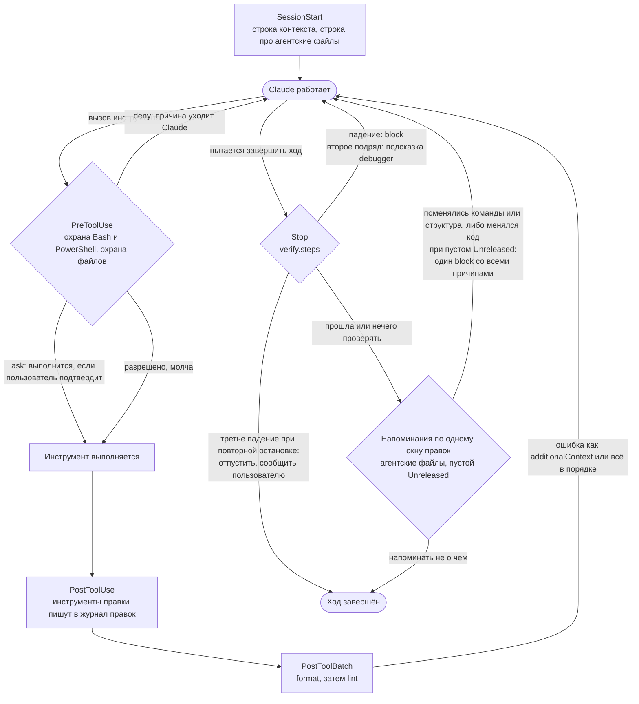

<a id="readme-top"></a>

<p align="center"><a href="README.md">English</a> · <b>Русский</b></p>

<h1 align="center">forge</h1>

<p align="center">
  <b>Дисциплина процесса для Claude Code — хуками, а не уговорами в промпте.</b><br/>
  Охрана git и секретов · формат и линт после правок · проверка перед завершением хода · выбор модели для субагентов
</p>

<p align="center">
  <a href="https://github.com/lunasy26/forge/actions/workflows/test.yml"></a>
  <a href="CHANGELOG.md"></a>
  <a href="LICENSE"></a>
  <a href="package.json"></a>
  <a href="package.json"></a>
  <a href="https://code.claude.com/docs/ru/plugins"></a>
</p>

<p align="center">
  <a href="#установка">Установка</a> ·
  <a href="#быстрый-старт">Быстрый старт</a> ·
  <a href="#возможности">Возможности</a> ·
  <a href="#как-это-работает">Как это работает</a> ·
  <a href="#документация">Документация</a> ·
  <a href="CHANGELOG.md">Изменения</a>
</p>

```
/plugin marketplace add lunasy26/forge
/plugin install forge@forge-dev
```

Всё, что должно происходить всегда или никогда, делают хуки и CLI `forge`; скиллы остаются там, где нужно суждение.

## Зачем forge

- **Механика вместо уговоров.** Правила, которые должны соблюдаться каждый раз, живут в хуках и CLI, а не в тексте промпта капслоком, который модель может и не выполнить.
- **Страховка с первой сессии.** Push в `main`, force push, `--no-verify`, правка `.env` и ключей останавливаются, в Bash и в PowerShell, даже в проекте, где forge не настраивали.
- **Ход не заканчивается на красном.** После правок перед завершением хода запускается проверка; падение возвращается Claude, второе подряд передаётся роли `debugger`, а третье отпускает сессию, чтобы не зациклиться.
- **Своя модель под каждую работу.** Каждая роль-субагент получает модель и effort из таблицы, а один переключатель (`eco`, `normal`, `max`) сдвигает всю таблицу.
- **Тихо по умолчанию.** На разрешённые действия ничего не выводится, начало сессии добавляет не больше 600 символов, без профиля в репозиторий ничего не пишется.

В проекте без `.forge/profile.json` работают только [охрана Bash](docs/ru/guards.md#охрана-bash), [охрана PowerShell](docs/ru/guards.md#охрана-powershell) и [охрана файлов](docs/ru/guards.md#охрана-файлов) со встроенными значениями (защищены ветки `main` и `master`, `.env*` и ключи). Линта и автопроверки нет, хуки ничего не пишут в репозиторий. В git-репозитории без профиля начало сессии добавляет одну строку с подсказкой `/forge:init`, вне git-репозитория — ничего.

> [!NOTE]
> forge говорит на языке, на котором вы пишете, — по-русски или по-английски: вывод CLI, причины хуков (с префиксом `forge:`) и ошибки профиля. Язык берётся из вашего последнего сообщения в сессии, затем из запомненного языка и системной локали, иначе — английский. Закрепить язык можно полем профиля `"language": "ru"` (или `"en"`) и переменной `FORGE_LANG`; подробности — в разделе [«Язык сообщений»](docs/ru/hooks.md#язык-сообщений). В [документации](#документация) сообщения приведены по-русски дословно.

<p align="right"><a href="#readme-top">↑ наверх</a></p>

## Установка

<p align="center"><a href="#требования">Требования</a> · <a href="#macos">macOS</a> · <a href="#linux">Linux</a> · <a href="#windows">Windows</a> · <a href="#проверка-установки">Проверка</a> · <a href="#обновление">Обновление</a> · <a href="#локальная-разработка">Локальная разработка</a></p>

### Требования

| | |
|---|---|
| **Node.js ≥ 20** | в `PATH`; хуки и CLI — чистый Node без зависимостей, `npm install` не нужен |
| **git** и **`/bin/sh`** | команды проверки, формата и линта запускаются через `/bin/sh`, а на Windows — через Git Bash |
| **Claude Code** | с хуками плагинов, включая событие `PostToolBatch` |
| **ОС** | macOS, Linux, Windows (нативно с Git for Windows или через WSL 2) |

Репозиторий публичный, учётные данные не нужны. `forge-dev` в команде установки — имя маркетплейса из `.claude-plugin/marketplace.json`: репозиторий сам себе маркетплейс. Подробнее — [установка плагинов](https://code.claude.com/docs/ru/discover-plugins) и [маркетплейсы плагинов](https://code.claude.com/docs/ru/plugin-marketplaces).

### macOS

1. **Node.js и git.** Через [Homebrew](https://brew.sh):

   ```bash
   brew install node git
   ```

   Без Homebrew git даёт `xcode-select --install`, а установщик Node есть на [nodejs.org](https://nodejs.org/ru/download).

2. **Claude Code** ([инструкция по установке](https://code.claude.com/docs/ru/setup)):

   ```bash
   curl -fsSL https://claude.ai/install.sh | bash
   ```

3. **forge.** Запусти `claude` в любом каталоге и выполни:

   ```
   /plugin marketplace add lunasy26/forge
   /plugin install forge@forge-dev
   ```

### Linux

1. **Node.js и git.** Node из дистрибутива подойдёт, если он не старше 20:

   ```bash
   sudo apt install nodejs git        # Debian, Ubuntu
   sudo dnf install nodejs git        # Fedora
   sudo pacman -S nodejs git          # Arch
   ```

   Проверь `node --version`. В старых LTS-выпусках Debian и Ubuntu Node младше 20 — тогда поставь его через [nvm](https://github.com/nvm-sh/nvm#installing-and-updating) (`nvm install --lts`) или с [nodejs.org](https://nodejs.org/ru/download).

2. **Claude Code** ([инструкция по установке](https://code.claude.com/docs/ru/setup)):

   ```bash
   curl -fsSL https://claude.ai/install.sh | bash
   ```

3. **forge.** Запусти `claude` и выполни:

   ```
   /plugin marketplace add lunasy26/forge
   /plugin install forge@forge-dev
   ```

### Windows

Два пути: **нативно** (PowerShell и [Git for Windows](https://git-scm.com/download/win)) или внутри **WSL 2**, где forge ведёт себя так же, как на Linux.

#### Нативный Windows

1. **Node.js и Git for Windows.** В PowerShell:

   ```powershell
   winget install OpenJS.NodeJS.LTS
   winget install Git.Git
   ```

   Или установщики с [nodejs.org](https://nodejs.org/en/download) и [git-scm.com](https://git-scm.com/download/win). После установки открой новый терминал, чтобы обновился `PATH`.

2. **Claude Code** ([инструкция по установке](https://code.claude.com/docs/ru/setup)), в PowerShell:

   ```powershell
   irm https://claude.ai/install.ps1 | iex
   ```

3. **forge.** Запусти `claude` и выполни:

   ```
   /plugin marketplace add lunasy26/forge
   /plugin install forge@forge-dev
   ```

Если Claude Code не находит Git Bash, укажи путь к нему в `settings.json`:

```json
{ "env": { "CLAUDE_CODE_GIT_BASH_PATH": "C:\\Program Files\\Git\\bin\\bash.exe" } }
```

> [!NOTE]
> Команды проверки, формата и линта запускаются в Git Bash, он ставится вместе с Git for Windows. Без него охрана работает (в том числе [охрана PowerShell](docs/ru/guards.md#охрана-powershell)), а эти проверки не запускаются; найден ли Git Bash, показывает `forge doctor`.

#### WSL 2

1. **WSL 2.** В PowerShell от имени администратора, затем перезагрузи компьютер:

   ```powershell
   wsl --install
   ```

   По умолчанию ставится Ubuntu. Подробнее — [установка WSL](https://learn.microsoft.com/ru-ru/windows/wsl/install).

2. **Всё остальное — в терминале WSL.** Открой Ubuntu из меню «Пуск» и пройди шаги для [Linux](#linux). Держи проекты в файловой системе WSL (`~/…`, а не `/mnt/c/…`): так намного быстрее. Команду `claude` запускай в терминале WSL, а не в PowerShell; в VS Code открывай папку через [расширение WSL](https://code.visualstudio.com/docs/remote/wsl).

### Проверка установки

1. В Claude Code открой `/plugin` → **Installed**: `forge` в списке и включён.
2. Открой git-проект и выполни `/forge:init`. Скилл покажет профиль, спросит о том, что не удалось определить, запишет `.forge/profile.json` и закончит `forge doctor`.
3. Строки `✗` в выводе `forge doctor` — то, что нужно поправить, например команда проверки, которой нет в `PATH`. Повторить можно в любой момент: попроси Claude выполнить `forge doctor`.

### Обновление

У сторонних маркетплейсов автообновление по умолчанию выключено. Обнови список, затем плагин и перезагрузи плагины:

```
/plugin marketplace update forge-dev
```

```bash
claude plugin update forge@forge-dev
```

```
/reload-plugins
```

Вместо команды в оболочке можно нажать **Update marketplace** на вкладке **Marketplaces** в `/plugin`. Что изменилось в каждой версии — [CHANGELOG.md](CHANGELOG.md).

### Локальная разработка

```bash
claude --plugin-dir /path/to/forge
```

Пока плагин включён, CLI `forge` доступен в Bash-инструменте Claude Code. Вне Claude Code — `node /path/to/forge/bin/forge <команда>`. Работа над самим forge — в разделе [Разработка](docs/ru/development.md).

### Конфликт с Superpowers

forge заменяет Superpowers и конфликтует с ним. Если в `enabledPlugins` включён `superpowers@…` (читаются `~/.claude/settings.json` или `$CLAUDE_CONFIG_DIR/settings.json`, затем `.claude/settings.json` и `.claude/settings.local.json` проекта; более поздний файл перекрывает более ранний), forge предупреждает в [начале сессии](docs/ru/hooks.md#контекст-в-начале-сессии) и в [`forge doctor`](docs/ru/cli.md#команды). Отключи его через `/plugin`. Superpowers распознаётся только по `enabledPlugins` в этих трёх файлах настроек.

<p align="right"><a href="#readme-top">↑ наверх</a></p>

## Быстрый старт

```
/forge:init → forge doctor → /forge:docs → /forge:mode, /forge:plan → /forge:execute → /forge:review
```

1. **`/forge:init`** в проекте. Скилл запускает `forge init` (только показ), показывает стек, шаги проверки, `verify.on_stop`, защищённые ветки и рискованные пути, спрашивает только о том, что не удалось [определить](docs/ru/profile.md#автоопределение-стека), затем пишет [профиль](docs/ru/profile.md) (`forge init --yes`; см. [что пишет init](docs/ru/profile.md#что-пишет-init)) и запускает `forge doctor`.
2. **`forge doctor`.** Строки `✗` в его выводе — то, что нужно поправить (например, команда проверки, которой нет в `PATH`).
3. **`/forge:docs`**, если в проекте нет `AGENTS.md`: `/forge:init` предложит его в конце. Скилл готовит черновик [агентских файлов](docs/ru/agent-docs.md#схема-файлов) по проекту и ничего не пишет без твоего «да». Если не хватает только ссылок `CLAUDE.md`, `/forge:init` предложит `forge docs --fix`.
4. **Обычная работа.** Мелкие правки делай как обычно — [линт](docs/ru/hooks.md#формат-и-линт-после-правок) и [проверка](docs/ru/hooks.md#автопроверка-при-завершении-хода) сработают сами. `/forge:mode eco|normal|max` выбирает [таблицу моделей](docs/ru/routing.md#модели-по-режимам).
5. **Фича на несколько файлов**: `/forge:plan` (спека и план задач, ждёт «да»), затем `/forge:execute` и `/forge:review`. См. [Скиллы](docs/ru/skills.md).

<p align="right"><a href="#readme-top">↑ наверх</a></p>

## Возможности

| Возможность | Что даёт |
|---|---|
| [Охрана Bash](docs/ru/guards.md#охрана-bash) | `deny` для `git push` в защищённые ветки, force push, `--mirror`, `--no-verify`; `ask` перед `git reset --hard`, `git push --all` и `rm -r` за пределами проекта. Видит команды внутри `bash -c`, `eval` и `$(…)` |
| [Охрана PowerShell](docs/ru/guards.md#охрана-powershell) | Те же правила для инструмента PowerShell в Claude Code (на Windows он основной); конструкция, которую не удалось прочитать, получает `ask` |
| [Охрана файлов](docs/ru/guards.md#охрана-файлов) | `deny` для инструментов правки на `.env*`, ключах и путях из `protected_files` |
| [Формат и линт](docs/ru/hooks.md#формат-и-линт-после-правок) | После каждой пачки вызовов инструментов `format` и `lint` идут по только что изменённым файлам; ошибки приходят Claude как контекст |
| [Автопроверка](docs/ru/hooks.md#автопроверка-при-завершении-хода) | `verify.steps` перед завершением хода; падение не даёт завершить ход, второе подряд зовёт `debugger`, третье отпускает |
| [Агентские файлы](docs/ru/agent-docs.md#схема-файлов) | `AGENTS.md` — источник, `CLAUDE.md` подключает его; `forge docs` проверяет схему, `/forge:docs` пишет файлы |
| [Напоминание про агентские файлы](docs/ru/agent-docs.md#напоминание-про-агентские-файлы) | Если за ход поменялись команды или структура проекта, Claude один раз просят проверить `AGENTS.md`/`CLAUDE.md` |
| [Выпуски и CHANGELOG](docs/ru/releases.md) | Включаемый раздел `release`: `forge release` проверяет журнал в формате Keep a Changelog, показывает и делает выпуск (журнал, файлы версий, коммит, тег; ничего не пушит); напоминание, если код менялся, а `[Unreleased]` пуст; `/forge:release` |
| [Контекст в начале сессии](docs/ru/hooks.md#контекст-в-начале-сессии) | До 600 символов: режим, проверки, активная задача, предупреждения |
| [Профиль](docs/ru/profile.md) | `.forge/profile.json` со схемой JSON; автоопределение стека для Node/TS, Python, Swift, Go и Rust |
| [Маршрутизация моделей](docs/ru/routing.md) | Модель и effort для каждой роли из таблицы `eco`/`normal`/`max`, проверенной инвариантами; псевдонимы можно [сопоставить с другими моделями](docs/ru/routing.md#другие-модели); `forge doctor` проверяет настройку моделей |
| [Скиллы](docs/ru/skills.md) | `/forge:init`, `/forge:mode`, `/forge:plan`, `/forge:execute`, `/forge:review`, `/forge:docs`, `/forge:release` |
| [CLI forge](docs/ru/cli.md) | `init`, `state`, `mode`, `route`, `verify`, `docs`, `release`, `doctor` |

<p align="right"><a href="#readme-top">↑ наверх</a></p>

## Как это работает



[SessionStart](docs/ru/hooks.md#контекст-в-начале-сессии) добавляет короткий контекст. Каждый вызов инструмента проходит [охрану Bash](docs/ru/guards.md#охрана-bash), [охрану PowerShell](docs/ru/guards.md#охрана-powershell) или [охрану файлов](docs/ru/guards.md#охрана-файлов). Правки попадают в журнал, после каждой пачки идут [формат и линт](docs/ru/hooks.md#формат-и-линт-после-правок). Когда Claude пытается завершить ход, запускается [автопроверка](docs/ru/hooks.md#автопроверка-при-завершении-хода), затем одноразовые напоминания по одному общему окну правок: [про агентские файлы](docs/ru/agent-docs.md#напоминание-про-агентские-файлы) и, если в профиле есть раздел `release`, [про пустой `[Unreleased]`](docs/ru/releases.md#напоминание-про-пустой-unreleased). Если сработали оба, Claude получает один блок с обеими причинами. Все хуки — в [таблице хуков](docs/ru/hooks.md#таблица-хуков).

<p align="right"><a href="#readme-top">↑ наверх</a></p>

## Документация

| Страница | Что внутри |
|---|---|
| [Хуки](docs/ru/hooks.md) | таблица хуков, fail-open и fail-closed, контекст в начале сессии, формат и линт после правок, автопроверка при завершении хода, напоминания в конце хода |
| [Охрана](docs/ru/guards.md) | охрана Bash, охрана PowerShell и охрана файлов: как читается команда, правила и вердикты, сокращённые опции git, рекурсивный `rm`, защищённые ветки и файлы |
| [Профиль](docs/ru/profile.md) | `.forge/profile.json`: пример, каждое поле со значением по умолчанию, сломанный профиль, автоопределение стека, что пишет `forge init` |
| [Маршрутизация моделей](docs/ru/routing.md) | роли, модели по режимам, лестница повторов, инварианты, переопределения, другие модели и провайдеры |
| [Агентские файлы](docs/ru/agent-docs.md) | схема `AGENTS.md`/`CLAUDE.md`, `forge docs` и коды замечаний, напоминание про агентские файлы |
| [Выпуски и CHANGELOG](docs/ru/releases.md) | `forge release`, выбор уровня, файлы версии, проверки журнала, напоминание про пустой `[Unreleased]`, `/forge:release` |
| [Скиллы](docs/ru/skills.md) | все скиллы `/forge:*` и формат задачи в плане |
| [CLI forge](docs/ru/cli.md) | все команды с кодами выхода, корень проекта |
| [Файлы и состояние](docs/ru/state.md) | каталог `.forge/`, файл состояния, журнал правок и его курсоры |
| [Разработка](docs/ru/development.md) | структура репозитория, тесты, новое правило охраны или роль |

<p align="right"><a href="#readme-top">↑ наверх</a></p>

## Ссылки

**Документы проекта**

- [CHANGELOG.md](CHANGELOG.md) — история изменений.
- [docs/spec.md](docs/spec.md) — спецификация и обоснование решений. Начиналась как черновик v0.1; раздел об этапах перечисляет и то, что ещё не сделано: уровни задач и `risky_paths` в хуках, `SubagentStart`, агенты `mechanic` и `architect`, скиллы `debug` и `finish`.
- [AGENTS.md](AGENTS.md) — правила разработки forge для людей и агентов.

<details>
<summary><b>Документация Claude Code</b></summary>

- [Справочник по хукам](https://code.claude.com/docs/ru/hooks) — события, матчеры, `decision`, `additionalContext`, `PostToolBatch`.
- [Плагины](https://code.claude.com/docs/ru/plugins) и [справочник манифеста плагина](https://code.claude.com/docs/ru/plugins-reference) — устройство и манифест плагина.
- [Маркетплейсы плагинов](https://code.claude.com/docs/ru/plugin-marketplaces) — как работает `/plugin marketplace add`.
- [Субагенты](https://code.claude.com/docs/ru/sub-agents) — файлы агентов, `model` и инструменты.
- [Скиллы](https://code.claude.com/docs/ru/skills) — `SKILL.md`, `description`, `disable-model-invocation`.
- [Память](https://code.claude.com/docs/ru/memory) — `CLAUDE.md`, импорт через `@`, вложенные файлы.
- [Настройка модели](https://code.claude.com/docs/ru/model-config) — псевдонимы моделей, `ANTHROPIC_DEFAULT_*_MODEL`, effort.

</details>

<details>
<summary><b>Стандарты</b></summary>

- [AGENTS.md](https://agents.md/) — открытый формат инструкций для агентов.
- [Keep a Changelog](https://keepachangelog.com/ru/1.1.0/) — формат CHANGELOG.
- [Семантическое версионирование](https://semver.org/lang/ru/) — номера версий.

</details>

<p align="right"><a href="#readme-top">↑ наверх</a></p>

## Лицензия

MIT — см. [LICENSE](LICENSE).
