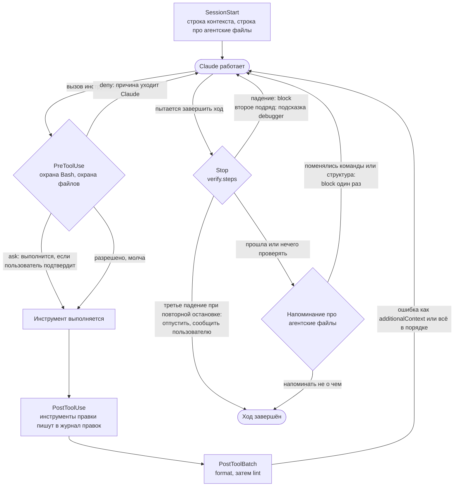

[English](README.md) · **Русский**

# forge

Плагин Claude Code, который даёт сессии дисциплину процесса хуками, а не уговорами в промпте: охрана git и секретов, формат и линт после правок, проверка перед завершением хода, профиль проекта и выбор модели и effort для ролей-субагентов.

[](https://github.com/lunasy26/forge/actions/workflows/test.yml)
[](CHANGELOG.md)
[](LICENSE)
[](package.json)
[](package.json)
[](https://code.claude.com/docs/ru/plugins)

Всё, что должно происходить всегда или никогда, делают хуки и CLI `forge`; скиллы остаются там, где нужно суждение.

В проекте без `.forge/profile.json` работает только [охрана Bash](#охрана-bash) и [охрана файлов](#охрана-файлов) со встроенными значениями (защищены ветки `main` и `master`, `.env*` и ключи). Линта и автопроверки нет, хуки ничего не пишут в репозиторий. В git-репозитории без профиля начало сессии добавляет одну строку с подсказкой `/forge:init`, вне git-репозитория — ничего.

> Всё, что forge показывает пользователю и Claude, — по-русски: вывод CLI, причины хуков (с префиксом `forge:`) и ошибки профиля. Ниже эти сообщения приведены дословно.

## Оглавление

- [Зачем forge](#зачем-forge)
- [Возможности](#возможности)
- [Жизненный цикл сессии](#жизненный-цикл-сессии)
- [Требования](#требования)
- [Установка](#установка)
  - [Из GitHub](#из-github)
  - [Локальная разработка](#локальная-разработка)
  - [Конфликт с Superpowers](#конфликт-с-superpowers)
- [Быстрый старт](#быстрый-старт)
  - [Что пишет init](#что-пишет-init)
- [Хуки](#хуки)
  - [Таблица хуков](#таблица-хуков)
  - [Fail-open и fail-closed](#fail-open-и-fail-closed)
- [Охрана Bash](#охрана-bash)
  - [Как читается команда](#как-читается-команда)
  - [Правила охраны](#правила-охраны)
  - [Сокращённые длинные опции](#сокращённые-длинные-опции)
  - [Рекурсивный rm](#рекурсивный-rm)
  - [Защищённые ветки](#защищённые-ветки)
- [Охрана файлов](#охрана-файлов)
  - [Синтаксис шаблонов](#синтаксис-шаблонов)
- [Формат и линт после правок](#формат-и-линт-после-правок)
- [Автопроверка при завершении хода](#автопроверка-при-завершении-хода)
  - [Падения подряд](#падения-подряд)
- [Агентские файлы](#агентские-файлы)
  - [Схема файлов](#схема-файлов)
  - [Команда forge docs](#команда-forge-docs)
  - [Коды замечаний](#коды-замечаний)
  - [Исправление и JSON](#исправление-и-json)
- [Напоминание про агентские файлы](#напоминание-про-агентские-файлы)
  - [Что считается изменением](#что-считается-изменением)
  - [Что закрывает напоминание](#что-закрывает-напоминание)
  - [Память о напоминаниях](#память-о-напоминаниях)
  - [Порядок и когда молчит](#порядок-и-когда-молчит)
- [Контекст в начале сессии](#контекст-в-начале-сессии)
- [Профиль](#профиль)
  - [Пример](#пример)
  - [Поля профиля](#поля-профиля)
  - [Сломанный профиль](#сломанный-профиль)
  - [Автоопределение стека](#автоопределение-стека)
- [Маршрутизация моделей](#маршрутизация-моделей)
  - [Роли](#роли)
  - [Модели по режимам](#модели-по-режимам)
  - [Как скиллы вызывают роль](#как-скиллы-вызывают-роль)
  - [Лестница повторов](#лестница-повторов)
  - [Инварианты](#инварианты)
  - [Переопределения из профиля](#переопределения-из-профиля)
- [Скиллы](#скиллы)
  - [Формат задачи в плане](#формат-задачи-в-плане)
- [CLI forge](#cli-forge)
  - [Команды](#команды)
  - [Корень проекта](#корень-проекта)
- [Файлы и состояние](#файлы-и-состояние)
  - [Каталог .forge](#каталог-forge)
  - [Файл состояния](#файл-состояния)
  - [Журнал правок](#журнал-правок)
- [Разработка](#разработка)
  - [Структура репозитория](#структура-репозитория)
  - [Запуск тестов](#запуск-тестов)
  - [Как тестируются хуки](#как-тестируются-хуки)
  - [Новое правило охраны](#новое-правило-охраны)
  - [Новая роль](#новая-роль)
- [Ограничения](#ограничения)
  - [Охрана](#охрана)
  - [Правки в обход инструментов правки](#правки-в-обход-инструментов-правки)
  - [Напоминание и forge docs](#напоминание-и-forge-docs)
  - [Прочее](#прочее)
- [Ссылки](#ссылки)
  - [Документы проекта](#документы-проекта)
  - [Документация Claude Code](#документация-claude-code)
  - [Стандарты](#стандарты)
- [Лицензия](#лицензия)

## Зачем forge

- **Механика вместо уговоров.** Правила, которые должны соблюдаться каждый раз, живут в хуках и CLI, а не в тексте промпта капслоком, который модель может и не выполнить.
- **Страховка с первой сессии.** Push в `main`, force push, `--no-verify`, правка `.env` и ключей останавливаются даже в проекте, где forge не настраивали.
- **Ход не заканчивается на красном.** После правок перед завершением хода запускается проверка; падение возвращается Claude, второе подряд передаётся роли `debugger`, а третье отпускает сессию, чтобы не зациклиться.
- **Своя модель под каждую работу.** Каждая роль-субагент получает модель и effort из таблицы, а один переключатель (`eco`, `normal`, `max`) сдвигает всю таблицу.
- **Тихо по умолчанию.** На разрешённые действия ничего не выводится, начало сессии добавляет не больше 600 символов, без профиля в репозиторий ничего не пишется.

[↑ К оглавлению](#оглавление)

## Возможности

| Возможность | Что даёт |
|---|---|
| [Охрана Bash](#охрана-bash) | `deny` для `git push` в защищённые ветки, force push, `--mirror`, `--no-verify`; `ask` перед `git reset --hard`, `git push --all` и `rm -r` за пределами проекта. Видит команды внутри `bash -c`, `eval` и `$(…)` |
| [Охрана файлов](#охрана-файлов) | `deny` для инструментов правки на `.env*`, ключах и путях из `protected_files` |
| [Формат и линт](#формат-и-линт-после-правок) | После каждой пачки вызовов инструментов `format` и `lint` идут по только что изменённым файлам; ошибки приходят Claude как контекст |
| [Автопроверка](#автопроверка-при-завершении-хода) | `verify.steps` перед завершением хода; падение не даёт завершить ход, второе подряд зовёт `debugger`, третье отпускает |
| [Агентские файлы](#агентские-файлы) | `AGENTS.md` — источник, `CLAUDE.md` подключает его; `forge docs` проверяет схему, `/forge:docs` пишет файлы. Новое в 0.3.0 |
| [Напоминание про агентские файлы](#напоминание-про-агентские-файлы) | Если за ход поменялись команды или структура проекта, Claude один раз просят проверить `AGENTS.md`/`CLAUDE.md`. Новое в 0.3.0 |
| [Контекст в начале сессии](#контекст-в-начале-сессии) | До 600 символов: режим, проверки, активная задача, предупреждения |
| [Профиль](#профиль) | `.forge/profile.json` со схемой JSON; автоопределение стека для Node/TS, Python, Swift, Go и Rust |
| [Маршрутизация моделей](#маршрутизация-моделей) | Модель и effort для каждой роли из таблицы `eco`/`normal`/`max`, проверенной инвариантами |
| [Скиллы](#скиллы) | `/forge:init`, `/forge:mode`, `/forge:plan`, `/forge:execute`, `/forge:review`, `/forge:docs` |
| [CLI forge](#cli-forge) | `init`, `state`, `mode`, `route`, `verify`, `docs`, `doctor` |

[↑ К оглавлению](#оглавление)

## Жизненный цикл сессии



[SessionStart](#контекст-в-начале-сессии) добавляет короткий контекст. Каждый вызов инструмента проходит [охрану Bash](#охрана-bash) или [охрану файлов](#охрана-файлов). Правки попадают в журнал, после каждой пачки идут [формат и линт](#формат-и-линт-после-правок). Когда Claude пытается завершить ход, запускается [автопроверка](#автопроверка-при-завершении-хода), затем одноразовое [напоминание про агентские файлы](#напоминание-про-агентские-файлы).

[↑ К оглавлению](#оглавление)

## Требования

- Node.js ≥ 20 в `PATH`. Зависимостей нет.
- `git` и `/bin/sh`: через него запускаются команды проверки. Поддерживаются macOS и Linux.
- Claude Code с хуками плагинов, включая событие `PostToolBatch`, и каталогом `bin/` плагина в `PATH` Bash-инструмента.

[↑ К оглавлению](#оглавление)

## Установка

### Из GitHub

Репозиторий публичный, учётные данные не нужны. В Claude Code:

```
/plugin marketplace add lunasy26/forge
/plugin install forge@forge-dev
```

`forge-dev` — имя маркетплейса из `.claude-plugin/marketplace.json`: репозиторий сам себе маркетплейс. Подробнее — [маркетплейсы плагинов](https://code.claude.com/docs/ru/plugin-marketplaces) в документации Claude Code.

### Локальная разработка

```bash
claude --plugin-dir /path/to/forge
```

Пока плагин включён, CLI `forge` доступен в Bash-инструменте Claude Code. Вне Claude Code — `node /path/to/forge/bin/forge <команда>`.

### Конфликт с Superpowers

forge заменяет Superpowers и конфликтует с ним. Если в `enabledPlugins` включён `superpowers@…` (читаются `~/.claude/settings.json` или `$CLAUDE_CONFIG_DIR/settings.json`, затем `.claude/settings.json` и `.claude/settings.local.json` проекта; более поздний файл перекрывает более ранний), forge предупреждает в [начале сессии](#контекст-в-начале-сессии) и в [`forge doctor`](#команды). Отключи его через `/plugin`.

[↑ К оглавлению](#оглавление)

## Быстрый старт

```
/forge:init → forge doctor → /forge:docs → /forge:mode, /forge:plan → /forge:execute → /forge:review
```

1. **`/forge:init`** в проекте. Скилл запускает `forge init` (только показ), показывает стек, шаги проверки, `verify.on_stop`, защищённые ветки и рискованные пути, спрашивает только о том, что не удалось [определить](#автоопределение-стека), затем пишет [профиль](#профиль) (`forge init --yes`) и запускает `forge doctor`.
2. **`forge doctor`.** Строки `✗` в его выводе — то, что нужно поправить (например, команда проверки, которой нет в `PATH`).
3. **`/forge:docs`**, если в проекте нет `AGENTS.md`: `/forge:init` предложит его в конце. Скилл готовит черновик [агентских файлов](#агентские-файлы) по проекту и ничего не пишет без твоего «да». Если не хватает только ссылок `CLAUDE.md`, `/forge:init` предложит `forge docs --fix`.
4. **Обычная работа.** Мелкие правки делай как обычно — [линт](#формат-и-линт-после-правок) и [проверка](#автопроверка-при-завершении-хода) сработают сами. `/forge:mode eco|normal|max` выбирает [таблицу моделей](#модели-по-режимам).
5. **Фича на несколько файлов**: `/forge:plan` (спека и план задач, ждёт «да»), затем `/forge:execute` и `/forge:review`. См. [Скиллы](#скиллы).

### Что пишет init

| Путь | Содержимое | В git |
|---|---|---|
| `.forge/profile.json` | [профиль](#профиль) проекта | на твоё усмотрение |
| `.forge/profile.schema.json` | копия схемы; профиль ссылается на неё через `"$schema"` — автодополнение в редакторе | вместе с профилем |
| `.git/info/exclude` | строки `.forge/state.json`, `.forge/edits.jsonl`, `.forge/work/`, `.forge/log/` | — |

Исключения пишутся в `info/exclude` общего git-каталога (действуют во всех worktree); `.gitignore` проекта не меняется. Закоммиченный профиль даёт всем, у кого стоит forge, те же проверки и охрану; коммить его вместе с `profile.schema.json`.

[↑ К оглавлению](#оглавление)

## Хуки

Каждый хук — `node hooks/<имя>.mjs`: читает JSON события со stdin и пишет ответ в stdout. События и поля ответа хуков описаны в [справочнике по хукам](https://code.claude.com/docs/ru/hooks) Claude Code.

### Таблица хуков

| Событие | Матчер | Скрипт | Что делает | Таймаут, с |
|---|---|---|---|---|
| `SessionStart` | `startup\|resume\|clear\|compact` | `session-start.mjs` | [Короткий контекст](#контекст-в-начале-сессии): режим, уровень, проверка, активная задача, предупреждения, строка про корневые агентские файлы | 10 |
| `PreToolUse` | `Bash` | `pre-bash.mjs` | [Охрана](#охрана-bash) git и `rm -r`: `deny` или `ask` с причиной | 10 |
| `PreToolUse` | `Edit\|Write\|MultiEdit\|NotebookEdit` | `pre-edit.mjs` | [Охрана файлов](#охрана-файлов): `deny` для `protected_files` | 10 |
| `PostToolUse` | `Edit\|Write\|MultiEdit\|NotebookEdit` | `post-edit.mjs` | Дописывает путь в [журнал правок](#журнал-правок) `.forge/edits.jsonl`; без профиля ничего не делает | 10 |
| `PostToolBatch` | — | `post-batch.mjs` | [`format` и `lint`](#формат-и-линт-после-правок) по файлам, изменённым с прошлого раза | 180 |
| `Stop` | — | `stop.mjs` | [`verify.steps`](#автопроверка-при-завершении-хода), если после последней проверки были правки; затем одно [напоминание про агентские файлы](#напоминание-про-агентские-файлы), если поменялись команды или структура | 600 |

Когда действие разрешено, охранные хуки ничего не выводят, и дальше действуют обычные разрешения Claude Code. `deny` отклоняет вызов и передаёт причину Claude, `ask` просит подтверждения у пользователя. Причины — по-русски, с префиксом `forge:`, например:

```
forge: git push --force запрещён. Для своей ветки используй --force-with-lease.
```

### Fail-open и fail-closed

При внутренней ошибке хук записывает её в лог и выходит с кодом 0 без вывода (fail-open): сбой forge не блокирует работу. Лог — `.forge/log/errors.log`, если в проекте есть `.forge/`, иначе `forge-errors.log` во временном каталоге системы; последние ошибки показывает [`forge doctor`](#команды).

Исключение — охранные хуки `pre-bash` и `pre-edit`: если сломалась сама проверка, они отвечают `ask` и пишут ошибку в тот же лог (fail-closed). Причина — `forge: внутренняя ошибка проверки … не могу убедиться, что она безопасна. Подтверди.` (у `pre-edit` — «не могу убедиться, что правка разрешена»). Нечитаемый JSON на stdin по-прежнему даёт молчаливый выход: проверять нечего.

[↑ К оглавлению](#оглавление)

## Охрана Bash

### Как читается команда

Это не полноценный разбор shell, а консервативное разбиение:

- строка делится на простые команды по `;`, `&&`, `||`, `|`, `&`, `(`, `)` и переводам строк; кавычки снимаются, комментарии и цели перенаправлений не считаются аргументами;
- перед именем команды отбрасываются присваивания (`FOO=1`), обёртки `sudo`, `env`, `command`, `exec`, `nohup`, `time`, `nice`, `builtin` вместе с их флагами `-…` и слова `if`, `then`, `else`, `elif`, `while`, `until`, `do`, `{`, `}`, `!`; имя сравнивается по basename (`/usr/bin/git` — это `git`);
- `cd <каталог>` меняет каталог для следующих команд той же строки (важно для путей `rm -r` и определения текущей ветки), `git -C <каталог>` — для этой команды;
- строка после `bash`/`sh`/`zsh`/`dash`/`ksh` с флагом `-c` проверяется как отдельная команда. `c` может стоять в любой связке коротких флагов (`-lc`, `-xc`, `-cx`), `-o`/`-O` берут значение (`-o pipefail`), `--rcfile`/`--init-file` тоже, `--` пропускается; скрипт — первый аргумент после флагов. Аргументы `eval` (без ведущего `--`) склеиваются через пробел и проверяются так же;
- команды внутри подстановок `$(…)`, `` `…` ``, `<(…)`, `>(…)` проверяются так же, где бы подстановка ни стояла: в двойных кавычках, в `${x:-$(…)}`, внутри `$((…))`, в цели перенаправления, в теле heredoc с некавыченным разделителем (`<<EOF`). Сам текст тела heredoc командой не считается;
- буквальными остаются текст в одинарных кавычках, `\$(…)` в двойных кавычках и тела heredoc с кавыченным разделителем (`<<'EOF'`, `<<"EOF"`, `<<\EOF`);
- `$'…'` декодируется (`\n`, `\t`, `\'`, `\\` и т. п.), так что `$'git' push` — это `git push`; `\x`, `\u`, `\U`, восьмеричные коды и `\c` не декодируются, слово считается зависящим от выполнения. Внутри обычных двойных кавычек `$'` — просто текст;
- `\` + перевод строки склеивается там, где его склеивает bash: `"$\⏎(…)"` — это `$(…)`. В одинарных кавычках, комментариях и телах heredoc с кавыченным разделителем строки не склеиваются;
- терминатор heredoc `<<` не снимает ведущие табуляции — только `<<-`; у нескольких heredoc в одной строке тела читаются по очереди. Внутри `$(…)` тело заканчивается и на строке `EOF)` — как в bash; строка, которая только начинается с разделителя (`EOFx`), или терминатор, который bash 3.2 и bash 5 читают по-разному, дают `ask`;
- `case`/`esac` внутри `$(…)` считаются ключевыми словами только на месте команды (`$(grep -c case f)` не путает разбор), а внутри `case` после `in` и `;;` идут шаблоны: `(esac)` или `case)` там — шаблон, а не ключевое слово. Местом команды считаются и позиции после `name()`, `function NAME`, `time -p`, `coproc`; внутри `((…))` heredoc, кавычки и комментарии не ищутся, а подстановки `$(…)` в нём проверяются;
- вложенность `bash -c`, `eval` и подстановок проверяется на три уровня; глубже — `ask`. Незакрытая подстановка — тоже `ask`;
- вход, который разборщик не в силах проследить (вложенность глубже примерно 32 уровней `$(` или 64 `${`, либо больше примерно 40 шагов на символ), — `ask`;
- если сама охрана упала с ошибкой — `ask` (см. [Fail-open и fail-closed](#fail-open-и-fail-closed)).

Вердикты всех команд строки объединяются: `deny` важнее `ask`, `ask` важнее разрешения; причины победившего уровня склеиваются. `git reset --hard && git push origin main` получает `deny`.

### Правила охраны

| Команда | Вердикт | Подробности |
|---|---|---|
| `git push` в ветку из [`git.protected_branches`](#защищённые-ветки) | deny | Цель — из refspec: `main`, `HEAD:main`, `x:refs/heads/main`, `:main`, `--delete main`. `HEAD` и `@` — текущая ветка. Без refspec и без `--all` — текущая ветка. Запрещено и с `--force-with-lease` |
| `git push --force`, `-f` (и в связке флагов), `+refspec` | deny | Разрешён только `--force-with-lease` / `--force-if-includes` без `--force`, `-f` и `+refspec`, если цель не защищена. `--force` отменяет проверку аренды, поэтому `--force --force-with-lease` запрещён; `+refspec` приравнен к `--force` (консервативно) |
| `git push --mirror` | deny | |
| `git push --no-verify` | deny | |
| `git commit --no-verify`, `-n` (и в связке: `-nm "…"`) | deny | В `git commit -m -n` `-n` — текст сообщения, это разрешено |
| `git push --all`, `--branches` | ask | Отправит все локальные ветки, включая защищённые |
| `git reset --hard` | ask | |
| `rm -r`, `-R`, `--recursive` вне проекта или по непредсказуемому пути | ask | См. [Рекурсивный rm](#рекурсивный-rm) |
| `git push --dry-run`, `-n` | разрешено | Пробный запуск не проверяется |

Порядок проверок `git push`: `--mirror`, защищённая ветка, force, `--no-verify`, `--all`; срабатывает первое правило. Глобальные опции git перед подкомандой (`-C`, `-c`, `--git-dir`, `--work-tree`, `--namespace`, `--config-env`) пропускаются.

Типичная причина:

```
forge: push в защищённую ветку «main» запрещён (git.protected_branches). Работай в отдельной ветке и предложи пользователю PR или слияние.
```

### Сокращённые длинные опции

git принимает любой однозначный префикс длинной опции, поэтому любой префикс охраняемой опции читается как она сама: `--forc` и `--fo` — `--force`, `--no-verif` — `--no-verify`, `--mi` — `--mirror`, `--al` — `--all`, `--ha` — `--hard`. Охраняются `--force`, `--force-with-lease`, `--force-if-includes`, `--no-verify`, `--mirror`, `--all`, `--branches`, `--delete` у `push`, `--no-verify` у `commit`, `--hard` у `reset`. При неоднозначном префиксе побеждает первая опция списка (самая опасная). `--dry-run` должен быть написан полностью: сокращение не превращает команду в разрешённую.

### Рекурсивный rm

Нерекурсивный `rm` не проверяется. Для каждого пути рекурсивного удаления:

- путь зависит от выполнения (`$VAR`, `$(…)`, обратные кавычки) — `ask`;
- путь обрезается до первого `*`, `?` или `[` и разрешается от текущего каталога (`build/*` → `build/`);
- `/`, домашний каталог, корень проекта или его предок (`rm -rf .`, `rm -rf *` из корня) — `ask`;
- внутри проекта — разрешено;
- внутри временных каталогов (`os.tmpdir()`, `/tmp`, `/private/tmp`, `/var/folders`, `/private/var/folders`), но не сам каталог — разрешено;
- всё остальное (`../other`, `~/x`, `/etc`) — `ask`.

### Защищённые ветки

Без профиля — `main` и `master`. Поле профиля [`git.protected_branches`](#поля-профиля) **заменяет** этот список; `[]` снимает защиту веток. Шаблоны привязаны к началу и концу имени: `*` не переходит через `/`, `**` переходит. `release/*` защищает `release/1.2`, но не `release/1.2/hotfix`.

[↑ К оглавлению](#оглавление)

## Охрана файлов

Вызов `Edit`, `Write`, `MultiEdit` или `NotebookEdit` для пути из `protected_files` отклоняется (`deny`) с причиной. Путь берётся относительно корня проекта; файл вне проекта сравнивается по абсолютному пути, поэтому `**/id_ed25519` ловит и `~/.ssh/id_ed25519`.

Встроенный список действует всегда, [`protected_files`](#поля-профиля) из профиля дописывается после него:

```
.env  .env.*  .envrc  !.env.example  !.env.sample  !.env.template
**/*.pem  **/*.key  **/id_rsa  **/id_ed25519
```

### Синтаксис шаблонов

Как в `.gitignore`: шаблон без `/` совпадает на любой глубине; шаблон с `/` привязан к корню (кроме начинающихся с `**/`); `*` и `?` не переходят через `/`, `**` переходит; `{a,b}` — альтернатива; шаблон каталога покрывает всё внутри; побеждает последнее совпадение; `!шаблон` снимает защиту, в том числе встроенную (`"!.env"`). Тот же синтаксис у [`docs.watch`](#что-считается-изменением).

[↑ К оглавлению](#оглавление)

## Формат и линт после правок

`PostToolUse` дописывает каждый изменённый файл в [журнал правок](#журнал-правок) `.forge/edits.jsonl` — только дозаписью, чтобы параллельные хуки не мешали друг другу. `PostToolBatch` срабатывает один раз после пачки вызовов инструментов:

1. нет профиля или нет ни [`commands.format`](#поля-профиля), ни `commands.lint` — ничего не делает;
2. берёт файлы из журнала после курсора `lint_offset` (уникальные, существующие, внутри проекта) и сдвигает курсор;
3. запускает `format`, затем `lint`, до первого падения; общий бюджет — 150 с;
4. при падении возвращает `additionalContext`: шаг, команда и до 40 строк вывода (начало и конец). Claude получает это как контекст перед следующим шагом; ход не прерывается (`decision: "block"` на этом событии остановил бы цикл, и Claude не увидел бы причину).

`{files}` в команде заменяется списком файлов в кавычках оболочки; `ext` оставляет только файлы с этими расширениями; если файлов не осталось, шаг пропускается. Команда без `{files}` запускается целиком, по всему проекту, после каждой пачки с правками. Команды выполняются через `/bin/sh -c` в корне проекта с `CI=1`, `FORCE_COLOR=0`, `NO_COLOR=1`. Линт работает и при [`verify.on_stop: "off"`](#автопроверка-при-завершении-хода).

Контекст начинается с «forge: после правок» и заканчивается строкой «Исправь это до следующих шагов.».

[↑ К оглавлению](#оглавление)

## Автопроверка при завершении хода

`Stop`-хук:

- без профиля и пока работают фоновые субагенты или workflow не делает ничего — проверка случится, когда они закончат. При [`verify.on_stop: "off"`](#поля-профиля) или пустом `verify.steps` пропускает только проверку: [напоминание про агентские файлы](#напоминание-про-агентские-файлы) всё равно работает;
- если журнал правок вырос после прошлой проверки, прогоняет `verify.steps` по порядку до первого падения с общим бюджетом `verify.timeout_sec`. При `on_stop: "fast"` шаг `test` заменяется на `test_fast`, если тот задан и ему есть что проверять. Шаги с `{files}` получают файлы, изменённые после прошлой проверки;
- записывает результат в [`.forge/state.json`](#файл-состояния) (`verify`, `failures.verify_streak`): успех обнуляет счётчик падений, падение увеличивает его. [`forge verify`](#команды) ведёт тот же счётчик;
- успех — ход завершается молча; падение — `decision: "block"`: Claude получает шаг, команду, до 60 строк вывода и указание исправить или честно сказать пользователю, что проверка падает.

Причина блокировки начинается с `forge: проверка перед завершением не прошла.` и заканчивается указанием «Исправь и заверши работу снова. Если исправить нельзя — честно сообщи пользователю, что проверка падает.».

### Падения подряд

| Падений подряд | Поведение |
|---|---|
| 1 | Не даёт завершить ход, показывает Claude вывод |
| 2 и больше | То же плюс указание передать задачу роли [`debugger`](#роли) (`forge route debugger`) вместе с логом |
| 3 и больше, если это повторная остановка (`stop_hook_active`) | Не блокирует: пользователь получает сообщение «проверка падает N раз(а) подряд, автопроверка отпустила сессию» |

Если новых правок нет, а последняя проверка упала и пользователю об этом ещё не сообщали, хук один раз показывает ему сводку: `forge: последняя проверка не прошла (…)`. Поэтому остановка без новых правок после падения не зацикливается.

[↑ К оглавлению](#оглавление)

## Агентские файлы

Агентские файлы — `AGENTS.md` и `CLAUDE.md`. forge держит схему, в которой текст живёт в одном месте, а читают его все инструменты.

### Схема файлов

- **`AGENTS.md` — источник.** Корневой `AGENTS.md` — карта проекта: что это, каталоги, команды, правила, таблица областей со ссылками на вложенные файлы. Его читают Codex, Cursor и другие агенты (см. [agents.md](https://agents.md/)).
- **`CLAUDE.md` — подключение.** Рядом с каждым `AGENTS.md` лежит `CLAUDE.md` из одной строки `@AGENTS.md` (после неё можно добавить то, что нужно только Claude Code). Claude Code читает `CLAUDE.md`, а не `AGENTS.md` (см. [память Claude Code](https://code.claude.com/docs/ru/memory)), поэтому без этой строки он текст не увидит.
- **Вложенные файлы.** Большая область (пакет монорепозитория, подсистема со своими командами и правилами) получает свой `AGENTS.md` и такой же `CLAUDE.md`-шим. Claude Code подгружает вложенный `CLAUDE.md` по требованию, когда читает файлы этого каталога, — поэтому шим нужен и во вложенных каталогах: без него правила области не подтянутся. Корневой `AGENTS.md` должен упоминать каталог области (`backend/`, `` `backend` ``) — иначе остальные агенты о нём не узнают.

Создать, перенести и починить файлы помогает [`/forge:docs`](#скиллы); структуру проверяет [`forge docs`](#команда-forge-docs); устаревание ловит [напоминание в конце хода](#напоминание-про-агентские-файлы).

### Команда forge docs

`forge docs [--fix] [--json]` проверяет структуру агентских файлов детерминированно, без модели. Работает и без профиля (значения по умолчанию). Каталоги с агентскими файлами ищет так: в git-репозитории — `git ls-files` (отслеживаемые и неотслеживаемые, без игнорируемых), иначе обход каталогов глубиной до 6 и до 20 000 записей; пропускаются скрытые каталоги, `node_modules`, `vendor`, `dist`, `build`, `target`, `bin`, `obj`, `.venv`, `venv`, `__pycache__`, `Pods`, `DerivedData`; символические ссылки на каталоги обход не открывает, ссылки на файлы видит. Каталог `.forge/` не сканируется нигде (в нём лежат резервные копии `/forge:docs`). Есть ли в найденном каталоге `AGENTS.md` и `CLAUDE.md`, решается по диску: игнорируемый git файл рядом с найденным тоже считается. `CLAUDE.md` — символическая ссылка на соседний `AGENTS.md` — считается правильной ссылкой, как `@AGENTS.md`.

Вывод — строки `✗ <путь>: <сообщение> [<код>]` (ошибка) и `! <путь>: <сообщение> [<код>]` (предупреждение); без замечаний — `✓ Агентские файлы в порядке`. Код выхода 1, если есть хотя бы одна ошибка (`✗`); предупреждения (`!`) код не меняют. Неизвестный аргумент — код 2.

[`forge doctor`](#команды) добавляет строку: `✓ Агентские файлы в порядке` или `✗`/`!` `Агентские файлы: N замечаний — forge docs` (с согласованием: 1 замечание, 2 замечания); `!`, если все замечания — предупреждения. Код выхода `doctor` не меняется — всегда 0.

### Коды замечаний

| Код | Уровень | Когда | `--fix` |
|---|---|---|---|
| `missing-root` | ошибка | Нет корневого `AGENTS.md` (если корневой `CLAUDE.md` с содержимым, сообщение просит перенести его в `AGENTS.md`) | нет, `/forge:docs` |
| `missing-shim` | ошибка | Есть `AGENTS.md`, рядом нет `CLAUDE.md` | да: создаёт `CLAUDE.md` с `@AGENTS.md` |
| `no-import` | ошибка | Есть оба файла, но в `CLAUDE.md` нет строки `@AGENTS.md` вне блока кода (или `CLAUDE.md` не читается) | да, только если `CLAUDE.md` прочитан и пуст: заменяет его ссылкой; с содержимым — строку добавляешь сам |
| `claude-only` | предупреждение | Во вложенном каталоге `CLAUDE.md` с содержимым без `AGENTS.md` | нет |
| `fat-claude` | предупреждение | В `CLAUDE.md` больше 30 непустых строк, не считая `@AGENTS.md` | нет |
| `too-long` | предупреждение | Агентский файл каталога (`AGENTS.md`, иначе `CLAUDE.md`) длиннее [`docs.max_lines`](#поля-профиля) строк | нет |
| `unlisted` | предупреждение | Вложенный `AGENTS.md`, а ближайший агентский файл выше его каталог не упоминает (`dir/` или `` `dir` ``) | нет |
| `broken-link` | предупреждение | Markdown-ссылка `[…](путь)` ведёт в несуществующий путь. Внешние URL, `#якоря`, ссылки в блоках кода и в обратных кавычках не проверяются; `/путь` отсчитывается от корня, остальные — от каталога файла | нет |
| `verify-undocumented` | предупреждение | Команда шага из [`verify.steps`](#поля-профиля) (первые одно-два слова: `npm test`, `pytest`; у `npm`/`pnpm`/`yarn`/`bun run <скрипт>` — три; присваивания `FOO=1` и `cd <каталог> &&` в начале пропускаются) не встречается ни в одном агентском файле. Без агентских файлов не проверяется | нет |
| `incomplete-scan` | предупреждение | Обход каталогов (вне git) оборвался на лимите записей: часть файлов могла не попасть в проверку | нет |

### Исправление и JSON

`--fix` меняет только файлы `CLAUDE.md` и только пишет `@AGENTS.md` в отсутствующий или пустой файл; существующий текст он не трогает, файл, который не удалось прочитать, пустым не считает. Сначала печатает `создан <путь>` по каждому файлу и `пропущен <путь>: <причина>` по каждому исправимому замечанию, которое не стал чинить (файл уже есть, в том числе битая символическая ссылка; не пуст; не читается; не удалось записать), затем повторяет проверку и выдаёт обычный отчёт; код выхода — по повторной проверке.

`--json` печатает массив замечаний одной строкой (при чистом проекте — `[]`):

```json
[{"code":"missing-shim","level":"error","path":"backend/CLAUDE.md","message":"…","fixable":true}]
```

`fixable: true` у замечаний, которые чинит `--fix`. С `--json` строки «создан …» не печатаются, а «пропущен …» уходят в stderr.

Проекты, у которых уже есть `AGENTS.md` без `CLAUDE.md` в нескольких каталогах, обычно чинятся одной командой `forge docs --fix`.

Вложенный git-репозиторий (не подмодуль, а отдельный `.git` в подкаталоге) из родительского репозитория `forge docs` не видит: `git ls-files` показывает только `sub/`, а не файлы внутри. Запускай `forge docs` в самом вложенном репозитории.

[↑ К оглавлению](#оглавление)

## Напоминание про агентские файлы

После проверки `Stop` решает, не устарели ли `AGENTS.md` и `CLAUDE.md` (схема — в разделе [Агентские файлы](#агентские-файлы)). Напоминание — `decision: "block"` с причиной:

```
forge: в этой задаче изменились команды или структура: … Проверь, не устарели ли … — команды, карта каталогов, правила. Если обновлять нечего — так и скажи и заверши работу.
```

Текст короткий (не больше ~520 символов): списки изменений и файлов обрезаются до «… и ещё N». Отключается полем [`docs.remind: false`](#поля-профиля).

### Что считается изменением

Берутся файлы из [журнала правок](#журнал-правок) после курсора `docs.offset`. Изменение — одно из двух:

- файл подходит под [`docs.watch`](#поля-профиля) (по умолчанию `package.json`, `pyproject.toml`, `Cargo.toml`, `*.sln`, `Makefile`, `justfile`, `Taskfile.yml`, `docker-compose*.yml`, `compose*.yml`, `.github/workflows/**`, `.gitlab-ci.yml`; шаблон без `/` действует на любой глубине). `package.json` в git считается, только если его `scripts` отличаются от `HEAD` (порядок ключей не важен; нет в `HEAD` или не читается как JSON — считается) — правка зависимостей молчит. Git определяется для каждого `package.json` по его собственному каталогу (`git -C <каталог>`): проект без git в корне с репозиториями в подпапках и вложенный репозиторий или подмодуль внутри git-проекта сравниваются со своим `HEAD`. Вне git считается любая правка `package.json`; в репозитории без коммитов каждый `package.json` — «новый»;
- в git: файл лежит в каталоге верхнего уровня, которого нет в `HEAD`, и корневой `AGENTS.md` его не упоминает (`name/` или `` `name` ``). Скрытые каталоги, файлы в корне, файлы, игнорируемые git, и проект без коммитов не считаются; один каталог — одно изменение, в тексте «новый каталог name/». Вне git этого признака нет.

### Что закрывает напоминание

Правка в этом же окне `AGENTS.md` или `CLAUDE.md` с содержимым (не ссылки `@AGENTS.md`) в каталоге изменённого файла или в любом из его предков; правка корневого файла закрывает всё. В тексте напоминания называется ближайший к изменению агентский файл (`AGENTS.md`, иначе `CLAUDE.md`, иначе корневой `AGENTS.md`).

### Память о напоминаниях

forge помнит в [`state.json`](#файл-состояния) (`docs.reminded`), о чём уже напомнил: для каждого `package.json` — отпечаток его `scripts`, и имена новых каталогов верхнего уровня. Признак, который не изменился с напоминания (или был закрыт правкой агентского файла), повторно не напоминает: после напоминания про `scripts` правка одних зависимостей молчит, новые файлы в уже названном каталоге — тоже. Другие `scripts` (другой отпечаток) или другой новый каталог — напоминают снова. Запись забывается, когда признак совпал с `HEAD`: `scripts` снова равны закоммиченным, каталог закоммичен или упомянут в корневом `AGENTS.md`.

### Порядок и когда молчит

- После каждой остановки курсор `docs.offset` уходит в конец журнала, и те же правки повторно не разбираются.
- [Проверка](#автопроверка-при-завершении-хода) важнее. Упала проверка (`decision: "block"`) — напоминания нет, курсор остаётся, и оно придёт после следующей прошедшей проверки. Если проверка «отпустила сессию» после трёх падений, напоминания тоже нет (курсор на месте). Одноразовое сообщение «последняя проверка не прошла» может идти вместе с напоминанием в одном ответе.
- Молчит, если нет профиля, пока работают фоновые субагенты или workflow, если нет `AGENTS.md` ни в корне, ни в каталогах над изменёнными файлами (это проверяется до любых вызовов git), и при `docs.remind: false` — тогда `Stop` удаляет `state.docs`, чтобы старый курсор не держал обнуление журнала. `verify.on_stop: "off"` напоминание не отключает.
- Ошибка внутри напоминания пишется в лог и не мешает результату проверки: её `decision`/`systemMessage` возвращается как обычно.
- Первая остановка после обновления forge (курсора ещё нет) только записывает курсор: правки до неё не напоминаются.
- Курсор участвует в [обнулении журнала правок](#журнал-правок).

[↑ К оглавлению](#оглавление)

## Контекст в начале сессии

На `startup`, `resume`, `clear`, `compact`:

- нет профиля и не git-репозиторий — ничего, даже предупреждения про Superpowers (хук завершается сразу);
- git-репозиторий без профиля — одна строка с подсказкой `/forge:init`;
- с профилем — строка с режимом (из состояния, иначе из профиля), уровнем, шагами проверки, `on_stop` и напоминанием про `forge route <role>`; при необходимости строки про активную задачу (slug, стадия, путь к плану), упавшую последнюю проверку, число [ошибок профиля](#сломанный-профиль) и проигнорированные [переопределения `routing`](#переопределения-из-профиля);
- с профилем и без корневого `AGENTS.md` — строка `forge: нет AGENTS.md — /forge:docs поможет завести.`; если рядом есть `CLAUDE.md`, но он не подключает `AGENTS.md` (нет строки `@AGENTS.md` вне блока кода), — `forge: CLAUDE.md не подключает AGENTS.md — forge docs.` Проверяются только эти два файла, без обхода каталогов; `CLAUDE.md` — символическая ссылка на `AGENTS.md` — считается подключением; при исправной паре строки нет;
- [предупреждение про Superpowers](#конфликт-с-superpowers), если он включён, — в git-репозитории и с профилем, и без него.

Весь текст обрезается до 600 символов.

[↑ К оглавлению](#оглавление)

## Профиль

Профиль проекта — `.forge/profile.json`. Его вместе с копией схемы пишет [`forge init`](#автоопределение-стека).

### Пример

```json
{
  "$schema": "./profile.schema.json",
  "version": 1,
  "commands": {
    "format": "npx prettier --write --ignore-unknown {files}",
    "lint": { "run": "npx eslint {files}", "ext": [".ts", ".tsx"] },
    "typecheck": "npx tsc --noEmit",
    "test": "npm test",
    "test_fast": { "run": "npx vitest related --run {files}", "ext": [".ts", ".tsx"] }
  },
  "verify": { "steps": ["typecheck", "lint", "test"], "on_stop": "fast", "timeout_sec": 300 },
  "git": { "protected_branches": ["main", "master", "release/*"] },
  "protected_files": ["secrets/**", "!config/dev.key"],
  "risky_paths": ["**/migrations/**", ".github/workflows/**"],
  "docs": { "remind": true, "max_lines": 200 },
  "tdd": "encouraged",
  "mode": "normal",
  "routing": { "normal": { "implementer": "opus/medium" } }
}
```

### Поля профиля

| Поле | Тип | Если не задано | Смысл |
|---|---|---|---|
| `$schema` | string | — | `forge init` пишет `./profile.schema.json` |
| `version` | `1` | — | Версия формата |
| `commands` | объект: имя → строка или `{ "run": string, "ext": [".ext"] }` | `{}` | Команды оболочки. `format` и `lint` запускает [`PostToolBatch`](#формат-и-линт-после-правок); `test_fast` подменяет `test` в быстрой проверке; любые имена можно звать из `verify.steps` |
| `verify.steps` | string[] | `[]` | Имена из `commands` по порядку ([автопроверка](#автопроверка-при-завершении-хода)). Пустой список — автопроверки нет. Шаг, которого нет в `commands`, отбрасывается с ошибкой |
| `verify.on_stop` | `off` \| `fast` \| `full` | `fast` | `off` — Stop не проверяет; `fast` — `test_fast` вместо `test`; `full` — шаги как есть |
| `verify.timeout_sec` | целое 1–540 | `300` | Общий бюджет одной проверки на все шаги |
| `git.protected_branches` | string[] | `["main", "master"]` | [Ветки](#защищённые-ветки), куда нельзя пушить. **Заменяет** встроенный список, а не дополняет его; `[]` снимает защиту веток |
| `protected_files` | string[] | `[]` | **Дописывается** к [встроенному списку](#охрана-файлов); `!шаблон` снимает защиту |
| `risky_paths` | string[] | `[]` | Хуки его не применяют. Читает [`forge:plan`](#скиллы): работа здесь — уровень 3 и роль `senior` |
| `tdd` | `off` \| `encouraged` \| `required` | `encouraged` | Учитывают [скиллы](#скиллы): при `required` `forge:plan` ставит тестовые задачи раньше реализации, `forge:execute` передаёт настройку исполнителю. Хуки не применяют |
| `docs.remind` | boolean | `true` | `false` отключает [напоминание про агентские файлы](#напоминание-про-агентские-файлы) в конце хода; [`forge docs`](#команда-forge-docs) работает всегда |
| `docs.max_lines` | целое > 0 | `200` | Длиннее этого агентский файл получает замечание [`too-long`](#коды-замечаний) |
| `docs.watch` | string[] | встроенный список | **Дописывается** к встроенному (см. [Что считается изменением](#что-считается-изменением)); [синтаксис](#синтаксис-шаблонов) как у `protected_files`, `!шаблон` снимает, в том числе встроенный (`"!Makefile"`) |
| `mode` | `eco` \| `normal` \| `max` | `normal` | [Режим](#модели-по-режимам) по умолчанию; режим из `forge mode` хранится в состоянии и важнее профиля |
| `routing` | `{ режим: { роль: "model/effort" } }` | `{}` | Переопределения таблицы моделей, см. [Переопределения из профиля](#переопределения-из-профиля) |

### Сломанный профиль

Сломанный профиль не блокирует работу. Профиль накладывается на значения по умолчанию. Невалидный JSON — действуют все значения по умолчанию; невалидное поле — значение по умолчанию для этого поля, остальные применяются. Ошибки показывают [`forge doctor`](#команды) и (числом) [начало сессии](#контекст-в-начале-сессии).

### Автоопределение стека

`forge init` выбирает первый найденный стек в порядке ниже, остальные попадают в заметки. `verify.steps` — те из `typecheck`, `lint`, `test`, что нашлись. Ветки — `main`, `master` и ветка по умолчанию у `origin`; `risky_paths` — `**/migrations/**`, `.github/workflows/**`.

| Стек | Признаки | Команды |
|---|---|---|
| Node/TS | `package.json`; npm, pnpm, yarn или bun по lock-файлу | `format`: prettier или biome; `lint`: eslint по файлам или скрипт `lint`; `typecheck`: скрипт `typecheck`/`type-check` или `tsc --noEmit` при `tsconfig.json`; `test`: скрипт `test`; `test_fast`: `vitest related` или `jest --findRelatedTests` |
| Python | `pyproject.toml`, `setup.py`, `setup.cfg`, `requirements.txt`; префикс `uv run` или `poetry run` по lock-файлу | ruff format и check, mypy или pyright, `pytest -q` |
| Swift | `Package.swift`, `*.xcodeproj`, `*.xcworkspace` | swiftformat и swiftlint при их конфигах, `swift test` для SwiftPM; `on_stop: "off"` — тесты долгие |
| Go | `go.mod` | `gofmt -w {files}`, `go vet ./...`, `go test ./...` |
| Rust | `Cargo.toml` | `rustfmt {files}`, `cargo clippy`, `cargo test` |

[↑ К оглавлению](#оглавление)

## Маршрутизация моделей

Каждая роль получает модель и effort из таблицы режима. Основную сессию forge не трогает: её модель выбирает пользователь. Роли вызывают скиллы [`/forge:plan`, `/forge:execute`, `/forge:review` и `/forge:docs`](#скиллы); сами агенты — [субагенты](https://code.claude.com/docs/ru/sub-agents) Claude Code.

### Роли

| Роль | Кто исполняет | Для чего |
|---|---|---|
| `scout` | `forge:scout` (Read, Grep, Glob) | Найти и прочитать код, вернуть выжимку с `path:line` |
| `mechanic` | `forge:implementer` | Правка по точной инструкции |
| `implementer` | `forge:implementer` (Read, Grep, Glob, Edit, Write, Bash) | Задача плана |
| `senior` | `forge:implementer` | Задача, которую нельзя описать до конца или где ошибка дорога; первый повтор после падения implementer |
| `architect` | основная сессия (`agent=main`) | Спека и план; строка таблицы справочная |
| `reviewer` | `forge:reviewer` (Read, Grep, Glob, Bash) | Ревью диффа |
| `debugger` | `forge:debugger` (все инструменты) | Эскалация после повторных падений |

### Модели по режимам

| Роль | eco | normal | max |
|---|---|---|---|
| scout | haiku / low | haiku / low | sonnet / medium |
| mechanic | sonnet / low | sonnet / medium | sonnet / high |
| implementer | sonnet / medium | sonnet / high | opus / high |
| senior | sonnet / high | opus / high | opus / xhigh |
| architect | sonnet / high | opus / high | opus / xhigh |
| reviewer | sonnet / high | opus / high | fable / high |
| debugger | opus / high | fable / high | fable / high |

Сила сравнивается сначала по модели (`haiku` < `sonnet` < `opus` < `fable`), затем по effort (`low` < `medium` < `high` < `xhigh` < `max`). Режим переключают [`/forge:mode`](#скиллы) и [`forge mode`](#команды); значение по умолчанию — из поля профиля [`mode`](#поля-профиля).

### Как скиллы вызывают роль

Скилл выполняет [`forge route <role>`](#команды) и получает `role=… mode=… agent=… model=… effort=…`, затем вызывает агента из `agent=` с этими `model` и `effort`; при `agent=main` работу делает сама сессия. Поэтому `/forge:mode eco` меняет модели следующих вызовов без правки файлов агентов. `model` и `effort` во frontmatter агентов равны строке `normal` и нужны только как запасной вариант, если агента вызвали без них. У `mechanic` и `senior` своего файла нет: без `forge route` они получают значения implementer — `sonnet/high`, то есть senior окажется слабее, чем по таблице.

### Лестница повторов

Её применяет [`forge:execute`](#скиллы):

| Упала роль | Первый повтор, с логом падения | Второе падение |
|---|---|---|
| `mechanic` | `implementer` | `debugger` с обоими логами |
| `implementer` | `senior` | `debugger` |
| `senior` | `senior` | `debugger` |
| любая другая (например, `scout`) | та же роль | `debugger` |

Если и `debugger` не справился, скилл останавливается и сообщает пользователю, что заблокировано. Отдельно Stop-хук подсказывает `debugger` на [втором падении проверки подряд](#падения-подряд).

### Инварианты

`checkTable` в `lib/route.mjs`, для каждого режима:

- у каждой роли значение `model/effort` с известной моделью и effort; неизвестных ролей нет;
- reviewer не слабее implementer; senior не слабее implementer; reviewer не слабее senior; debugger не слабее senior;
- в `eco` нет `fable`.

Тесты дополнительно требуют, чтобы во встроенной таблице senior был строго сильнее implementer, frontmatter агентов совпадал со строкой `normal`, у scout не было Edit, Write и Bash, а у reviewer — Edit и Write.

### Переопределения из профиля

[`routing`](#поля-профиля) накладывается на встроенную таблицу по режимам и ролям, и результат проверяется теми же инвариантами. Любая ошибка — и игнорируется весь блок `routing` во всех режимах, действует встроенная таблица. Об этом сообщают [начало сессии](#контекст-в-начале-сессии) (числом), `forge doctor` (строки `✗ routing: …`), `forge mode` (строка `! переопределения routing …` в stdout) и `forge route` (в stderr). Переопределение может уравнять senior и implementer — тогда первый повтор просто повторит ту же модель.

[↑ К оглавлению](#оглавление)

## Скиллы

Скиллы — [скиллы](https://code.claude.com/docs/ru/skills) Claude Code из состава плагина; тяжёлую работу они отдают ролям через [`forge route`](#как-скиллы-вызывают-роль).

| Скилл | Кто вызывает | Что делает | Артефакты и состояние |
|---|---|---|---|
| `/forge:init` | только пользователь | [Определяет стек](#автоопределение-стека), согласует и пишет профиль, запускает `forge doctor`, затем `forge docs`: при `missing-root` предлагает `/forge:docs`, при `missing-shim` — `forge docs --fix` | `.forge/profile.json`, `.forge/profile.schema.json`, `.git/info/exclude` |
| `/forge:mode [eco\|normal\|max]` | только пользователь | Показывает или переключает [режим и таблицу](#модели-по-режимам) | `mode` в `.forge/state.json` |
| `/forge:plan` | модель (фича или правка на несколько файлов) или пользователь | Контекст через `scout`, до трёх вопросов, спека до ~40 строк, план задач с [ролями](#роли), проверками и группами для параллельного запуска; ждёт «да» | `.forge/work/<slug>/spec.md`, `plan.md`; `task.slug`, `stage: plan`, `tier` 2 (3 — если задеты [`risky_paths`](#поля-профиля)), `artifacts.spec`, `artifacts.plan` |
| `/forge:execute` | модель или пользователь | Готовые задачи — ролям через `forge route`, с непересекающимися файлами — параллельно; отмечает задачу только после прошедшей `check` (если отчёт её не показывает — запускает сам); [лестница повторов](#лестница-повторов); в конце `forge verify` и `forge:review` (всегда на уровне 3, на уровне 2 — если пользователь не отказался) | Отметки `[x]` в `plan.md`; `stage: execute`, затем `review` |
| `/forge:docs` | модель или пользователь | Заводит, переносит и делит [агентские файлы](#агентские-файлы) по схеме «AGENTS.md — источник, CLAUDE.md подключает его» (создать, перенести из корневого `CLAUDE.md` или чужих файлов правил, разделить длинное, починить ссылки). Начинает с `forge docs --json`, читает файлы сама, область исследует через `scout`; черновик показывает и ничего не пишет без «да». Перед правкой копирует затронутые файлы в `.forge/work/docs-backup/<время>/` (в git — при незаигнорированном `.forge/work/` в `<git-common-dir>/forge-docs-backup/<время>/`), переносит текст дословно и сверяет, что ни одна строка не пропала | Файлы `AGENTS.md`/`CLAUDE.md`, резервная копия; состояние не меняет |
| `/forge:review` | модель или пользователь | База — `git merge-base` с защищённой веткой; reviewer через `forge route` (дифф больше ~800 строк — несколько параллельно по областям); перепроверяет blocker и major; показывает находки по серьёзности и спрашивает, что чинить | `.forge/work/<slug>/review.md` (без активной задачи — `.forge/work/review.md`); `stage: review` |

### Формат задачи в плане

```markdown
- [ ] T1 <imperative title>
  role: implementer
  files: src/a.ts, src/a.spec.ts
  check: npm test -- a.spec
  depends: -
```

`role` — `implementer`, `mechanic`, `senior` или `scout`; `senior` — не больше трети задач плана. Агенты не коммитят, не пушат и не переключают ветки — git остаётся за основной сессией.

[↑ К оглавлению](#оглавление)

## CLI forge

### Команды

| Команда | Что делает | Код выхода |
|---|---|---|
| `forge init` | Показывает [стек](#автоопределение-стека), предлагаемый профиль и заметки; ничего не пишет | 0 |
| `forge init --yes [--force]` | Пишет профиль и копию схемы, добавляет [исключения](#что-пишет-init) в `.git/info/exclude`; существующий профиль перезаписывает только с `--force` | 0; 1 — профиль уже есть |
| `forge state [get [key]]` | [Состояние](#файл-состояния) целиком или поле по пути через точку (`task.slug`) | 0 |
| `forge state set <key> <value> […]` | Меняет поля парами; значение читается как JSON, иначе как строка. Проверяются `tier` (целое 0–3), `stage` (`spec`, `plan`, `execute`, `review`, `finish` или `null`), `mode` | 0; 2 — ошибка |
| `forge state reset` | Сбрасывает `tier` (на 1), `stage`, `task`, `artifacts`, `failures`; режим, результат проверки и курсоры остаются | 0 |
| `forge mode [eco\|normal\|max]` | Показывает или переключает [режим](#модели-по-режимам) (в состоянии) и печатает таблицу режима | 0; 2 — неизвестный режим |
| `forge route <role> [--json]` | `role=… mode=… agent=… model=… effort=…` или то же в JSON ([как это используют скиллы](#как-скиллы-вызывают-роль)) | 0; 2 — роль не указана или неизвестна |
| `forge route --table` | Таблица текущего режима | 0 |
| `forge verify [--fast] [--json]` | Прогоняет [`verify.steps`](#автопроверка-при-завершении-хода), записывает результат и счётчик падений; `--json` печатает `{ok, summary, failed, streak}` | 0 — прошла; 1 — упала, нет профиля или шагов |
| `forge docs [--fix] [--json]` | Проверяет `AGENTS.md`/`CLAUDE.md` ([коды и уровни](#коды-замечаний)); `--fix` создаёт недостающие и пустые `CLAUDE.md` со строкой `@AGENTS.md`; `--json` печатает массив `{code, level, path, message, fixable}` | 0 — ошибок нет (предупреждения допустимы); 1 — есть ошибка; 2 — неизвестный аргумент |
| `forge doctor` | Node, пути плагина и проекта, [валидность профиля](#сломанный-профиль), наличие исполняемых файлов команд проверки, исключения git, [таблица маршрутизации](#переопределения-из-профиля), [агентские файлы](#команда-forge-docs), [Superpowers](#конфликт-с-superpowers), последние [ошибки хуков](#fail-open-и-fail-closed) | всегда 0 |
| `forge help`, `-h`, `--help`, без аргументов | Справка | 0 |

Неизвестная команда (или подкоманда `state`) — код 2, внутренняя ошибка CLI — 3. Ошибки печатаются в stderr строкой `forge: …`.

### Корень проекта

Корень проекта для CLI и хуков: `CLAUDE_PROJECT_DIR`, если задан; иначе ближайший предок текущего каталога с `.forge/profile.json` (не выше домашнего); иначе корень git-репозитория; иначе текущий каталог.

[↑ К оглавлению](#оглавление)

## Файлы и состояние

### Каталог .forge

```
.forge/
├── profile.json          профиль (коммит — по желанию)
├── profile.schema.json   копия config/profile.schema.json
├── state.json            состояние сессии                        ┐
├── edits.jsonl           журнал правок                           │ в .git/info/exclude
├── work/<slug>/          spec.md, plan.md, review.md             │
└── log/errors.log        внутренние ошибки хуков                 ┘
```

### Файл состояния

`state.json`: `tier` (0–3, по умолчанию 1), `stage`, `mode` (`null` — из профиля), `task.slug`, `artifacts.spec` и `artifacts.plan`, `verify` (`at`, `ok`, `summary`, `failed_step`, `edits_offset`, `notified`), `failures.verify_streak`, `lint_offset`, `docs.offset` и `docs.reminded` ([память напоминаний](#память-о-напоминаниях)). Меняется только через [`forge state`](#команды) и хуки; повреждённый файл заменяется значениями по умолчанию. `forge state set`, `forge state reset` и `forge mode <режим>` создают его и без профиля.

### Журнал правок

`edits.jsonl`: строка `{"t": <мс>, "f": "<путь от корня>"}` на правку. [Линт](#формат-и-линт-после-правок), [проверка](#автопроверка-при-завершении-хода) и [напоминание про агентские файлы](#напоминание-про-агентские-файлы) хранят свои байтовые курсоры (`lint_offset`, `verify.edits_offset`, `docs.offset`). Когда все действующие курсоры догнали конец, а журнал не меньше 256 КБ, он обнуляется, и курсоры сбрасываются в 0. Курсора `docs.offset` может не быть (первая остановка после обновления; при `docs.remind: false` `Stop` удаляет `state.docs`) — тогда он не мешает обнулению; пока он есть и отстаёт, журнал сохраняется.

Состояние — одно на рабочую директорию. Параллельные сессии запускай в отдельных worktree.

[↑ К оглавлению](#оглавление)

## Разработка

### Структура репозитория

```
.claude-plugin/     plugin.json (манифест, версия), marketplace.json (маркетплейс forge-dev)
hooks/              hooks.json и тонкие обёртки над lib/: JSON со stdin → JSON в stdout
lib/                вся логика: guards, shell, glob, profile, state, edits, verify, docs, route, detect, cli, git, paths, settings, util
config/             routing.json (роли и таблица режимов), profile.schema.json
agents/             scout, implementer, reviewer, debugger
skills/             init, mode, plan, execute, review, docs
bin/forge           точка входа CLI
test/               node:test; helpers.mjs — временные репозитории, запуск хуков и CLI
docs/               spec.md — спецификация и решения
.github/workflows/  test.yml: npm test на Node 20, 22, 24
```

Устройство плагина — по [справочнику манифеста плагина](https://code.claude.com/docs/ru/plugins-reference) Claude Code.

### Запуск тестов

```bash
npm test                              # node --test test/*.test.mjs (без кавычек: glob раскрывает оболочка, Node 20 его не умеет)
node --test test/guards.test.mjs      # один файл
```

### Как тестируются хуки

`runHookScript(name, input, { projectDir })` из `test/helpers.mjs` запускает `node hooks/<name>.mjs`, подаёт событие JSON на stdin, задаёт `CLAUDE_PROJECT_DIR`, `CLAUDE_PLUGIN_ROOT` и изолированный `CLAUDE_CONFIG_DIR` (настройки разработчика не читаются) и возвращает код выхода, stdout и разобранный JSON. Проекты-фикстуры — `gitRepo(branch)` (временный репозиторий без подписи коммитов и git-хуков), `writeProfile`, `write`; CLI — `runCli(args, { cwd })`.

### Новое правило охраны

1. Логика — в `lib/guards.mjs` (`checkPush`, `checkCommit`, `checkGit`, `checkRm` или новая ветка по имени команды в `checkBash`); вердикт — `deny(…)` или `ask(…)` с причиной по-русски, начинающейся с `forge:`. Разбор команды — `lib/shell.mjs`.
2. Тесты в `test/guards.test.mjs`: запрещённые написания и похожие разрешённые; изменения разбора — в `test/glob-shell.test.mjs`.
3. [Таблица правил](#правила-охраны) в этом README (и в [README.md](README.md)) и запись в `CHANGELOG.md`.

### Новая роль

1. `config/routing.json`: `roles.<role>.agent` (существующий агент или `null` — основная сессия) и строка роли в каждом из `eco`, `normal`, `max`.
2. `config/profile.schema.json`: роль в `$defs.routingMode.properties` — там `additionalProperties: false`, без этого переопределение не пройдёт схему.
3. Если роль стоит на [лестнице](#лестница-повторов) — [инварианты](#инварианты) в `checkTable` (`lib/route.mjs`) и тесты в `test/route-profile.test.mjs`: встроенная таблица их проходит, нарушающие переопределения отклоняются.
4. Новый агент — `agents/<name>.md` с `model`/`effort`, равными строке `normal`, и его имя в списке теста frontmatter в `test/route-profile.test.mjs`.
5. Скиллы, которые вызывают роль; оба README и `CHANGELOG.md`.

Правила для тех, кто меняет forge (в том числе для агентов), — в [AGENTS.md](AGENTS.md).

[↑ К оглавлению](#оглавление)

## Ограничения

### Охрана

- **Охрана — страховочная сетка от ошибок, а не песочница.** Она не рассчитана на команду, которую нарочно прячут. [Не проверяется](#как-читается-команда):
  - скрипт, поданный оболочке через stdin: `… | bash`, `bash <<EOF`, `bash <<<'…'`, `bash -s`;
  - команда после обёртки с отдельным значением флага или не из списка: `sudo -u user …`, `nice -n 5 …`, `timeout 5 …`, `xargs …`, `coproc …`;
  - цель, известная только во время выполнения: `cd "$dir"`, `eval "$cmd"`, `bash -c "$script"`, `git push origin "$branch"`, refspec с недекодируемым `$'\x…'`;
  - команда, имя которой получается подстановкой: `$(true) git push --force origin main`, `${x:-}git push …`, `` `…`git push … ``, `$UNSET git push …`, `${x:-git push --force origin main}`. bash такие команды выполнит, охрана их пропустит. Пока принято так: охрана страхует от ошибок, а не от обхода;
  - `source`/`.`, алиасы и функции оболочки, `find -exec`, git-алиасы (`git -c alias.x='!…'`), скрипты, записанные в файл и запущенные (`./deploy.sh`, `npm run …`), другие интерпретаторы (`python -c`, `node -e`), `ssh`;
  - вход, который разборщик не может проследить (вложенность глубже примерно 32 уровней `$(` или 64 `${`, либо больше примерно 40 шагов на символ): целиком он не проверяется, команда получает `ask`.
- `git push` без refspec проверяется по имени текущей локальной ветки. Если upstream указывает на ветку с другим именем или в `remote.<name>.push` заданы свои refspec, охрана этого не видит ([Правила охраны](#правила-охраны)).
- `--no-verify` ловится только у `git commit` и `git push`. `git -c core.hooksPath=… commit`, `git merge --no-verify` и переменные окружения, отключающие хуки, не ловятся.
- Другие разрушительные команды не охраняются: `git clean`, `git checkout -- .`, `git restore`, `git branch -D`, `find -delete`, нерекурсивный `rm`.
- [Охрана файлов](#охрана-файлов) срабатывает только на инструменты правки. Чтение `.env` не блокируется, запись через Bash (`echo … > .env`, `sed -i`) не ловится.

### Правки в обход инструментов правки

- [Журнал правок](#журнал-правок) пишут только инструменты правки. Изменения, сделанные только через Bash (кодогенерация, `sed -i`, `git apply`), не запускают ни [линт](#формат-и-линт-после-правок), ни [проверку при завершении хода](#автопроверка-при-завершении-хода).
- [Напоминание](#напоминание-про-агентские-файлы) тоже видит только правки через инструменты правки: команда, изменённая через Bash, его не вызовет.

### Напоминание и forge docs

- Признаки напоминания считаются относительно `HEAD` своего репозитория, а повтор гасит [память о напоминаниях](#память-о-напоминаниях) (`docs.reminded`): тот же отпечаток `scripts` и тот же новый каталог второй раз не напоминают. Память видит только `scripts` и имена каталогов: другие файлы из `docs.watch` (workflow, `Makefile`) напоминают при каждой правке в новом окне, если в том же окне не правится агентский файл.
- Без git признаки грубее: первая правка `package.json` считается изменением команд, даже если поменялись только зависимости (дальше — только смена `scripts`); признака нового каталога нет. В репозитории без коммитов каждый `package.json` считается новым (первая правка напоминает), а признака нового каталога тоже нет.
- `docs.watch` не смотрит на содержимое, кроме `scripts` в `package.json`.
- [`forge docs`](#команда-forge-docs) проверяет структуру, а не смысл: устаревшие команды и пути в тексте он не находит (кроме `broken-link` и `verify-undocumented`). Это делает `/forge:docs`. `fixable`-замечания `--fix` чинит только для `CLAUDE.md`.

### Прочее

- `risky_paths`, уровни задач и `tdd` в 0.3.0 — подсказки для скиллов; хуки их не применяют. Что скилл вызовет роль через `forge route` с нужными `model` и `effort`, обеспечивает модель, а не механика ([Как скиллы вызывают роль](#как-скиллы-вызывают-роль)).
- [Журнал правок](#журнал-правок) обнуляется, только когда догнали все действующие курсоры (`verify.edits_offset`, `lint_offset`, `docs.offset`, если он есть). Курсор потребителя, который не работает (нет команд `format`/`lint`, `verify.on_stop: "off"`), остаётся 0 и не даёт обнулить журнал — так было и до `forge docs`.
- Одна сессия на рабочую директорию: две сессии в одном checkout делят `.forge/state.json` и журнал правок.
- Superpowers распознаётся только по `enabledPlugins` в [трёх файлах настроек](#конфликт-с-superpowers).

[↑ К оглавлению](#оглавление)

## Ссылки

### Документы проекта

- [CHANGELOG.md](CHANGELOG.md) — история изменений.
- [docs/spec.md](docs/spec.md) — спецификация и обоснование решений. Начиналась как черновик v0.1; раздел об этапах перечисляет и то, что ещё не сделано: уровни задач и `risky_paths` в хуках, `SubagentStart`, агенты `mechanic` и `architect`, скиллы `debug` и `finish`.
- [AGENTS.md](AGENTS.md) — правила разработки forge для людей и агентов.
- [LICENSE](LICENSE) — MIT.

### Документация Claude Code

- [Справочник по хукам](https://code.claude.com/docs/ru/hooks) — события, матчеры, `decision`, `additionalContext`, `PostToolBatch`.
- [Плагины](https://code.claude.com/docs/ru/plugins) и [справочник манифеста плагина](https://code.claude.com/docs/ru/plugins-reference) — устройство и манифест плагина.
- [Маркетплейсы плагинов](https://code.claude.com/docs/ru/plugin-marketplaces) — как работает `/plugin marketplace add`.
- [Субагенты](https://code.claude.com/docs/ru/sub-agents) — файлы агентов, `model` и инструменты.
- [Скиллы](https://code.claude.com/docs/ru/skills) — `SKILL.md`, `description`, `disable-model-invocation`.
- [Память](https://code.claude.com/docs/ru/memory) — `CLAUDE.md`, импорт через `@`, вложенные файлы.

### Стандарты

- [AGENTS.md](https://agents.md/) — открытый формат инструкций для агентов.
- [Keep a Changelog](https://keepachangelog.com/ru/1.1.0/) — формат CHANGELOG.
- [Семантическое версионирование](https://semver.org/lang/ru/) — номера версий.

[↑ К оглавлению](#оглавление)

## Лицензия

MIT — см. [LICENSE](LICENSE).

[↑ К оглавлению](#оглавление)
